<div align="center">

# ⚡ Types of Redis Caching in LLM Applications

### Make your LLM apps **faster** 🚀, **cheaper** 💸, **more reliable** 🛡️ and **safer** 🔐

*A hands-on learning series of 9 small Python projects — one caching pattern at a time.*

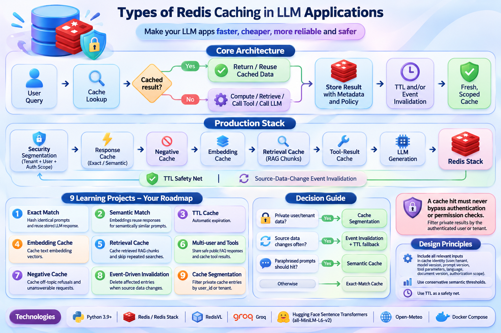
<br/>

[](https://www.python.org/)
[](https://redis.io/)
[](https://groq.com/)
[](https://docs.docker.com/compose/)
[](./LICENSE)

<br/>

[🎯 Overview](#-overview) •
[🗺️ Roadmap](#️-project-roadmap) •
[🧩 Architecture](#-how-the-patterns-fit-together) •
[🚀 Quick Start](#-quick-start) •
[🧪 Run Projects](#-running-the-projects) •
[🧭 Choose a Cache](#-choosing-the-right-cache) •
[🛠️ Troubleshooting](#️-common-troubleshooting)

</div>

---

## 🎯 Overview

LLM applications become **slow and expensive** when they repeatedly perform the same work. Redis provides a blazing-fast in-memory foundation for caching:

> 💬 prompts &nbsp;•&nbsp; 🧠 responses &nbsp;•&nbsp; 🔢 embeddings &nbsp;•&nbsp; 📚 retrieved context &nbsp;•&nbsp; 🔧 tool results &nbsp;•&nbsp; 👤 user-scoped data

This repository is a **progressive collection of small Python projects**. Each project focuses on **one caching pattern** and includes:

- ✅ Runnable code
- 🖼️ A visual architecture diagram
- 📖 Project-specific documentation

The series starts with a simple exact-match cache and gradually introduces semantic similarity, expiration, embeddings, retrieval, tool calls, negative results, event-driven invalidation, and security-focused cache segmentation.

### 📈 Your Learning Journey


> 🟢 **Foundations** &nbsp;→&nbsp; 🔵 **Intermediate** &nbsp;→&nbsp; 🔴 **Production-grade**

---

## 🎓 What You Will Learn

| | Skill |
| :-: | --- |
| 🔁 | Avoid duplicate LLM requests with **exact-match caching** |
| 🧠 | Reuse answers for **semantically similar** prompts |
| ⏳ | Expire cached values automatically with **Redis TTLs** |
| 🔢 | Cache **embedding vectors** separately from LLM responses |
| 📚 | Cache **retrieved RAG context** and skip repeated vector searches |
| 🤝 | **Share safe answers** across users and cache external tool results |
| 🚫 | Cache **refusals** and unanswerable requests |
| ⚡ | **Invalidate** stale entries immediately when source data changes |
| 🔐 | **Isolate private** cache entries by user or tenant |
| 🧭 | **Choose the right** cache strategy for your application |

---

## 🗺️ Project Roadmap

The projects are designed to be explored **in order**, but each directory can also be run **independently**.

| # | Project | 🏷️ Topic | 💡 Main idea |
| :-: | --- | --- | --- |
| 1️⃣ | [**Exact Match**](./project_1_exact_match) | Deterministic response caching | Hash an identical prompt and reuse its stored LLM response. |
| 2️⃣ | [**Semantic Match**](./project_2_semantic_match) | Meaning-based response caching | Use embeddings to reuse responses for semantically similar prompts. |
| 3️⃣ | [**TTL Cache**](./project_3_ttl_cache) | Automatic expiration | Attach a Redis expiration timer so cached responses do not live forever. |
| 4️⃣ | [**Embedding Cache**](./project_4_embedding_cache) | Vector reuse | Cache generated text embeddings and avoid repeating embedding computation. |
| 5️⃣ | [**Retrieval Cache**](./project_5_retrieval_cache) | RAG optimization | Cache retrieved document chunks and skip repeated vector-database searches. |
| 6️⃣ | [**Multi-user and Tools**](./project_6_multiuser_and_tools) | Shared and tool caching | Share safe FAQ answers and cache external tool results such as weather data. |
| 7️⃣ | [**Negative Cache**](./project_7_negative_cache) | Refusal caching | Cache off-topic and unanswerable responses to avoid repeated wasted LLM calls. |
| 8️⃣ | [**Event Invalidation**](./project_8_event_invalidation) | Freshness after writes | Delete affected cache entries immediately when source data changes. |
| 9️⃣ | [**Cache Segmentation**](./project_9_cache_segmentation) | Security and isolation | Prevent private data from leaking across users or tenants. |

---

## 🧩 How the Patterns Fit Together

Caching is **not one single technique**. Different layers reduce different kinds of work:

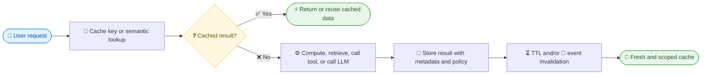

### 🏗️ The Full Production Stack

A complete production system may combine **several patterns across layers**:

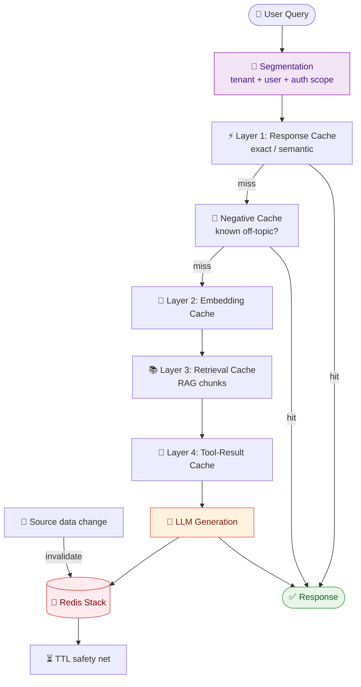

| 🧱 Pattern | 📝 Purpose |
| --- | --- |
| 🔢 Cache embeddings before semantic search | Skip repeated embedding computation |
| 📚 Cache retrieved context before LLM generation | Skip repeated vector searches |
| 🔧 Cache deterministic tool results with a short TTL | Avoid slow / rate-limited API calls |
| 🌍 Cache safe public answers across users | Maximize hit rate for shared content |
| 🔐 Segment private answers by tenant and user | Prevent data leaks |
| 📡 Invalidate affected entries when source data changes | Guarantee freshness |
| ⏳ Use TTL as a fallback when an event is missed | Bound staleness |

---

## 📁 Repository Structure

```text
Types-of-Redis-Caching-in-LLM/
├── 🐳 docker-compose.yaml
├── 📦 requirements.txt
├── 📜 LICENSE
├── 📖 README.md
│
├── 1️⃣ project_1_exact_match/
│   ├── README.md
│   ├── diagram.png
│   └── main.py
├── 2️⃣ project_2_semantic_match/
│   ├── README.md
│   ├── diagram.png
│   └── main.py
├── 3️⃣ project_3_ttl_cache/
│   ├── README.md
│   ├── diagram.png
│   └── main.py
├── 4️⃣ project_4_embedding_cache/
│   ├── README.md
│   ├── diagram.png
│   └── main.py
├── 5️⃣ project_5_retrieval_cache/
│   ├── README.md
│   ├── diagram.png
│   └── main.py
├── 6️⃣ project_6_multiuser_and_tools/
│   ├── README.md
│   ├── diagram.png
│   ├── part_a_multi_user.py
│   └── part_b_tool_cache.py
├── 7️⃣ project_7_negative_cache/
│   ├── README.md
│   ├── diagram.png
│   └── main.py
├── 8️⃣ project_8_event_invalidation/
│   ├── README.md
│   ├── diagram.png
│   └── main.py
└── 9️⃣ project_9_cache_segmentation/
    ├── README.md
    ├── diagram.png
    └── main.py
```

---

## 🧰 Technology Stack

| 🔧 Tool | 🎯 Role |
| --- | --- |
| 🐍 **Python** | Project implementations and interactive command-line demos |
| 🟥 **Redis** | Low-latency cache storage |
| 🧱 **Redis Stack** | Redis plus search and vector capabilities used by the RAG project |
| 🧬 **RedisVL** | Semantic caching, vectorization, indexing, filtering, and retrieval helpers |
| 🤖 **Groq** | LLM completion and tool-calling provider |
| 🤗 **Hugging Face Sentence Transformers** | Local text embeddings through `all-MiniLM-L6-v2` |
| 🌦️ **Open-Meteo** | External weather API used by the tool-cache example |
| 🐳 **Docker Compose** | Consistent local Redis Stack setup |

---

## 📋 Requirements

- 🐍 Python **3.9** or newer
- 🐳 Docker Desktop or Docker Engine with Compose support
- 🔑 A **Groq API key** for projects that call an LLM
- 🌐 Internet access to download the local embedding model and call external APIs

> 💡 **Tip:** Project 4 can run **without** a Groq API key because it demonstrates embedding caching only. The other projects that generate or summarize responses require `GROQ_API_KEY`.

---

## 🚀 Quick Start

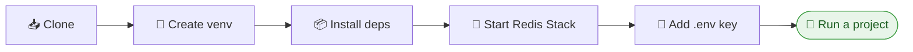

### 1️⃣ Clone the repository

```bash
git clone https://github.com/paras160500/Types-of-Redis-Caching-in-LLM.git
cd Types-of-Redis-Caching-in-LLM
```

### 2️⃣ Create and activate a virtual environment

<details open>
<summary>🍎🐧 <b>macOS / Linux</b></summary>

```bash
python3 -m venv .venv
source .venv/bin/activate
```

</details>

<details>
<summary>🪟 <b>Windows PowerShell</b></summary>

```powershell
python -m venv .venv
.venv\Scripts\Activate.ps1
```

</details>

### 3️⃣ Install dependencies

```bash
pip install -r requirements.txt
```

The repository currently declares:

```text
redis>=5.0.0
groq>=0.11.0
python-dotenv>=1.0.0
redisvl>=0.4.0
requests
```

> ℹ️ The embedding examples may also require the `sentence-transformers` dependency used by the local Hugging Face vectorizer. If your environment does not install it automatically, run:
>
> ```bash
> pip install sentence-transformers
> ```

### 4️⃣ Start Redis Stack 🟥

The repository includes a Docker Compose configuration:

```bash
docker compose up -d
```

This starts Redis Stack with:

| 🔌 Service | 📍 Address |
| --- | --- |
| 🟥 Redis | `localhost:6379` |
| 🔍 RedisInsight | `localhost:5540` |

<details>
<summary>🩺 <b>Verify, stop, and clean up</b></summary>

Check the container:

```bash
docker compose ps
```

Verify Redis:

```bash
redis-cli ping
```

Expected output:

```text
PONG
```

Stop the services:

```bash
docker compose down
```

Stop the services **and remove persisted container data**, if any is configured in your environment:

```bash
docker compose down -v
```

</details>

### 5️⃣ Configure your Groq API key 🔑

Create a `.env` file in the repository root:

```env
GROQ_API_KEY=your_groq_api_key_here
```

> ⚠️ **Never commit this file or expose the key in source control.** The repository's `.gitignore` is intended to help prevent accidental credential commits.

---

## 🧪 Running the Projects

> 📌 Run each project **from the repository root** so that relative paths and environment configuration stay consistent.

### 1️⃣ Project 1 — Exact Match 🎯

```bash
python project_1_exact_match/main.py
```

Ask the **same prompt twice**. The first request calls Groq; the second returns the response from Redis using a **SHA-256 key**.

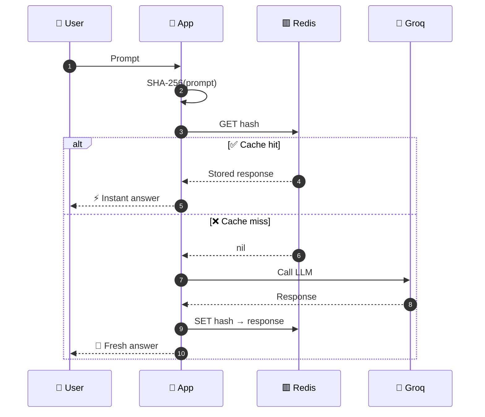

📖 [Read the Project 1 README](./project_1_exact_match/README.md)

---

### 2️⃣ Project 2 — Semantic Match 🧠

```bash
python project_2_semantic_match/main.py
```

Ask two questions with **similar meaning**. RedisVL compares embeddings and can return a response for a semantically similar prompt.

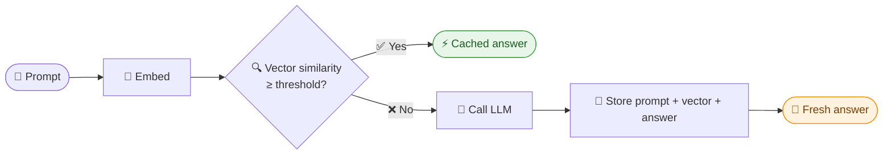

📖 [Read the Project 2 README](./project_2_semantic_match/README.md)

---

### 3️⃣ Project 3 — TTL Cache ⏳

```bash
python project_3_ttl_cache/main.py
```

The demo uses a **20-second TTL**. Ask the same prompt immediately for a hit, wait for expiration, then ask again to trigger a fresh LLM call.

```mermaid
gantt
    title ⏳ 20-second TTL demo
    dateFormat  ss
    axisFormat  %Ss
    section Cache entry
    Stored and valid (HIT)   :active, a1, 00, 20s
    Expired (MISS)           :crit, a2, after a1, 10s
```

📖 [Read the Project 3 README](./project_3_ttl_cache/README.md)

---

### 4️⃣ Project 4 — Embedding Cache 🔢

```bash
python project_4_embedding_cache/main.py
```

This project **does not call an LLM**. It caches the embedding vector generated for **normalized text** and reports embedding-cache hits and misses.

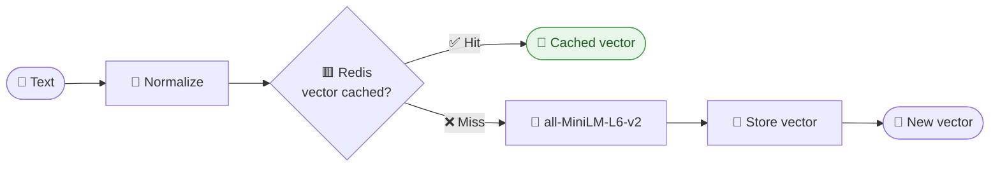

📖 [Read the Project 4 README](./project_4_embedding_cache/README.md)

---

### 5️⃣ Project 5 — Retrieval Cache 📚

```bash
python project_5_retrieval_cache/main.py
```

This RAG demo caches **retrieved document chunks**. A retrieval-cache hit **skips the vector-database search**, but the LLM still generates a fresh answer using the cached context.

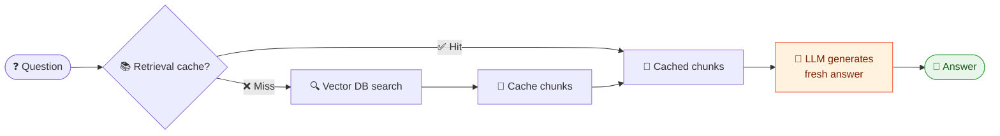

📖 [Read the Project 5 README](./project_5_retrieval_cache/README.md)

---

### 6️⃣ Project 6 — Multi-user and Tools 🤝🔧

**Part A** — shared semantic-cache example:

```bash
python project_6_multiuser_and_tools/part_a_multi_user.py
```

**Part B** — weather tool-cache example:

```bash
python project_6_multiuser_and_tools/part_b_tool_cache.py
```

The first part demonstrates **shared public FAQ responses**. The second caches **Open-Meteo** weather results for **10 minutes** while Groq handles tool selection and final response generation.

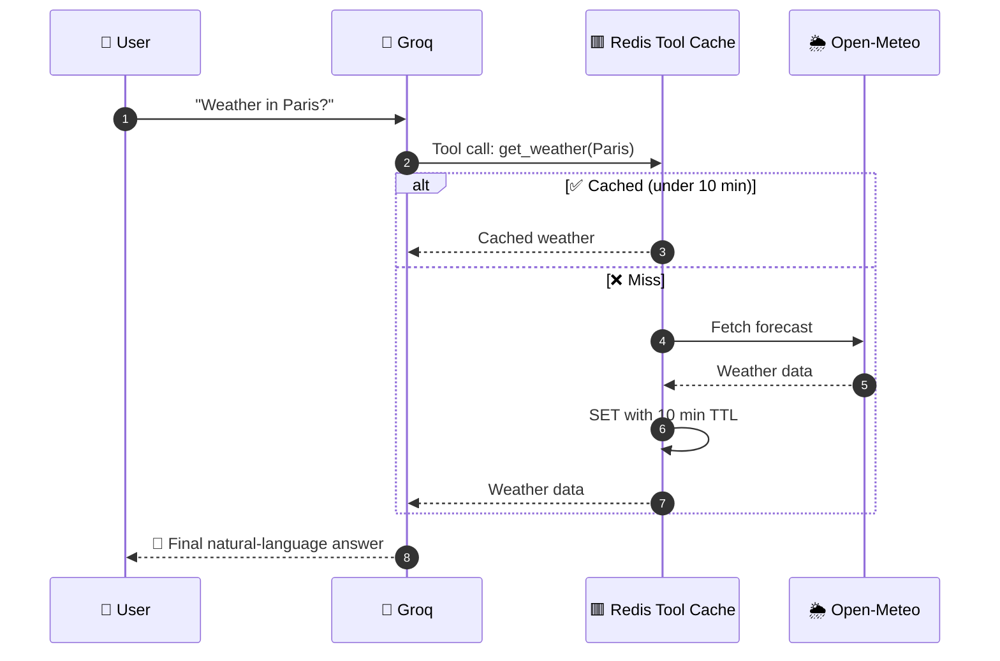

📖 [Read the Project 6 README](./project_6_multiuser_and_tools/README.md)

---

### 7️⃣ Project 7 — Negative Cache 🚫

```bash
python project_7_negative_cache/main.py
```

The scoped tutor caches **refusals** for off-topic prompts with a **shorter TTL**, while valid answers use a **longer TTL**.

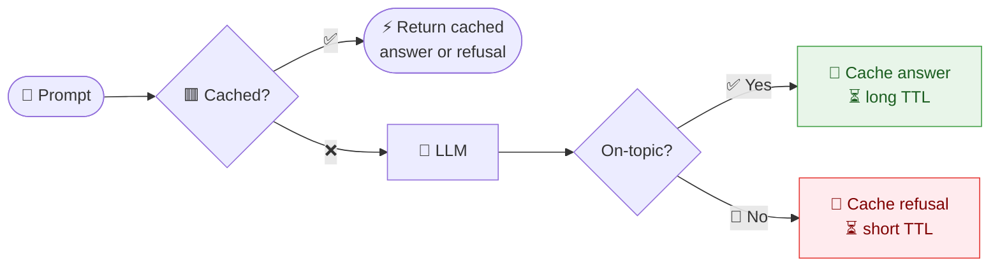

📖 [Read the Project 7 README](./project_7_negative_cache/README.md)

---

### 8️⃣ Project 8 — Event-Driven Invalidation 📡

```bash
python project_8_event_invalidation/main.py
```

Cache entries are **tagged by product ID**. Updating a product price **immediately removes only the affected product's** cached responses.

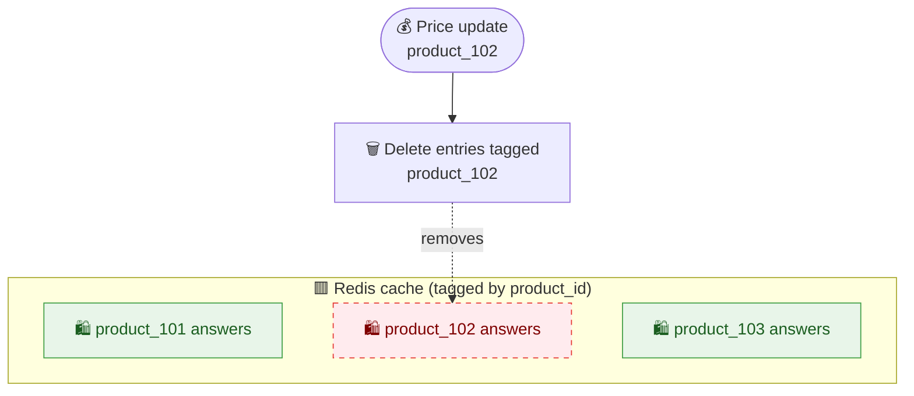

📖 [Read the Project 8 README](./project_8_event_invalidation/README.md)

---

### 9️⃣ Project 9 — Cache Segmentation 🔐

```bash
python project_9_cache_segmentation/main.py
```

The demo first **reproduces a cross-user data leak** with segmentation disabled, then enables `user_id` **filtering** to isolate private cached responses.

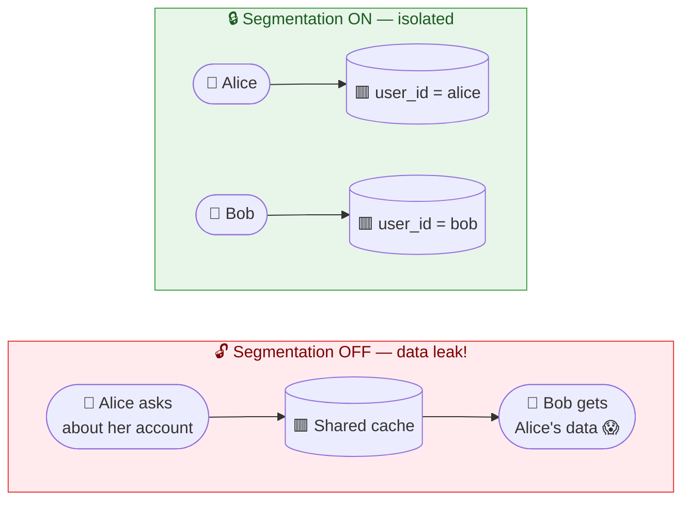

📖 [Read the Project 9 README](./project_9_cache_segmentation/README.md)

---

## 🧭 Choosing the Right Cache

Use the following decision guide as a starting point:

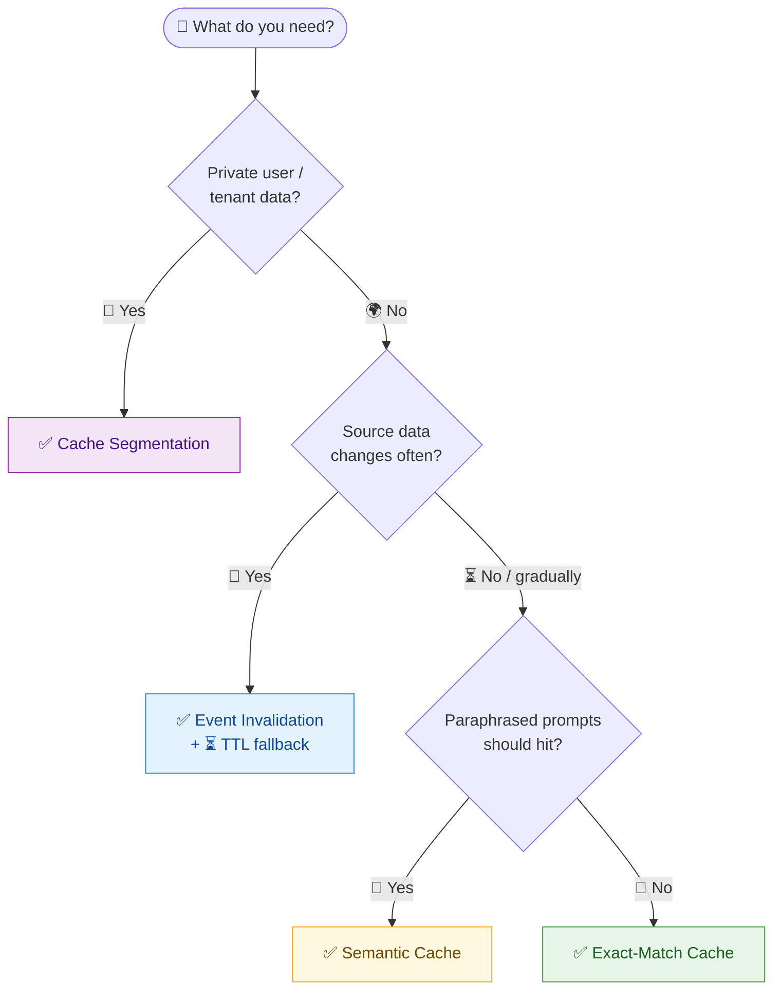

| 📌 Requirement | ✅ Recommended pattern |
| --- | --- |
| Only identical prompt text should reuse an answer | 🎯 Exact-match cache |
| Paraphrased prompts should reuse an answer | 🧠 Semantic response cache |
| Cached data must expire automatically | ⏳ TTL cache |
| Embedding computation is repeated frequently | 🔢 Embedding cache |
| Vector search is repeated for similar queries | 📚 Retrieval cache |
| External tool calls are slow or rate-limited | 🔧 Tool-result cache |
| Off-topic requests repeatedly waste tokens | 🚫 Negative cache |
| Source data changes must invalidate answers immediately | 📡 Event-driven invalidation |
| Responses contain private user or tenant data | 🔐 Cache segmentation |

---

## 🏛️ Important Design Principles

### 🎚️ Cache the right layer
Caching a final LLM answer, an embedding, retrieved context, and a tool result are **different decisions**. Choose the layer that is **expensive to recompute** and **safe to reuse**.

### 🔑 Include all relevant inputs in cache identity
A cache key or filter should account for **every value that can change the result**, including:

- 👤 User or tenant identity
- 🤖 Model and embedding-model version
- 📝 System prompt version
- 🔧 Tool version and parameters
- 🌍 Language and locale
- 📦 Product or document version
- 🛂 Authorization scope

### 🧪 Treat semantic matches carefully
Semantic similarity **does not prove** that two questions have the same correct answer. Use **conservative thresholds**, representative test sets, and domain-specific validation.

### 🛟 Use TTL as a safety net
TTL is useful **even when event-driven invalidation is available**. It limits the lifetime of entries if an event is missed, delayed, or incorrectly processed.

### 🚨 Never use caching as authorization
A cache hit **must not bypass** authentication or permission checks. Private results must be filtered by the authenticated user's or tenant's scope before they are returned.

---

## 🛠️ Common Troubleshooting

<details>
<summary>🟥 <b>Redis is not available</b></summary>

<br/>

Start the services and test Redis:

```bash
docker compose up -d
redis-cli ping
```

If vector search is required, use the repository's **Redis Stack** Compose configuration rather than a minimal Redis image.

</details>

<details>
<summary>🐢 <b>The first run is slow</b></summary>

<br/>

The local embedding model is downloaded and initialized on first use. Later runs can use the local model cache.

</details>

<details>
<summary>🔑 <b><code>GROQ_API_KEY</code> errors</b></summary>

<br/>

Check that:

- ✅ The `.env` file is in the repository root.
- ✅ The variable is named exactly `GROQ_API_KEY`.
- ✅ The key is valid.
- ✅ The configured model is available to your Groq account.

</details>

<details>
<summary>🧐 <b>Cache results look incorrect</b></summary>

<br/>

Clear the relevant cache and retry:

```text
clear
```

Then check whether the **similarity threshold**, **cache scope**, **TTL**, **model version**, or **source-data version** needs adjustment.

</details>

---

## 🏭 Production Considerations

> ⚠️ These projects are **educational examples**. Before using similar patterns in production, add:

- [ ] ⚙️ Structured configuration through environment variables
- [ ] 🔒 Redis authentication, TLS, network controls, and least-privilege access
- [ ] 🔁 Timeouts, retries, and fallback behavior for Redis, LLMs, embeddings, and tools
- [ ] 📊 Metrics for cache-hit rate, miss rate, latency, token savings, storage, and stale results
- [ ] 🏷️ Cache namespaces for model, prompt, tool, document, and authorization versions
- [ ] 🗑️ Explicit invalidation for updates that make cached data stale
- [ ] 👥 Tenant and user segmentation for all private or permission-dependent responses
- [ ] 🧪 Tests for semantic false positives and cross-user data leakage
- [ ] 🚦 Request coalescing or distributed locks for high-concurrency cache misses
- [ ] 🕵️ Privacy controls for prompts, embeddings, retrieved documents, and responses

---

## 📜 License

This project is licensed under the [MIT License](./LICENSE).

© 2026 **Paras Patel**

---

## 🙏 Acknowledgements

| | Project | Thanks for |
| :-: | --- | --- |
| 🟥 | [Redis](https://redis.io/) | The in-memory data store, TTL support, filtering, and vector-search capabilities |
| 🧬 | [RedisVL](https://redis.io/docs/latest/develop/ai/redisvl/) | The semantic-cache and vectorization integrations |
| ⚡ | [Groq](https://groq.com/) | LLM completion and tool-calling support |
| 🤗 | [Hugging Face](https://huggingface.co/) & [Sentence Transformers](https://www.sbert.net/) | The local embedding model ecosystem |
| 🌦️ | [Open-Meteo](https://open-meteo.com/) | The weather API used in the tool-cache demonstration |

---

<div align="center">

### ⭐ If this series helped you, consider giving the repo a star! ⭐

**Happy caching!** ⚡🟥🤖

</div>