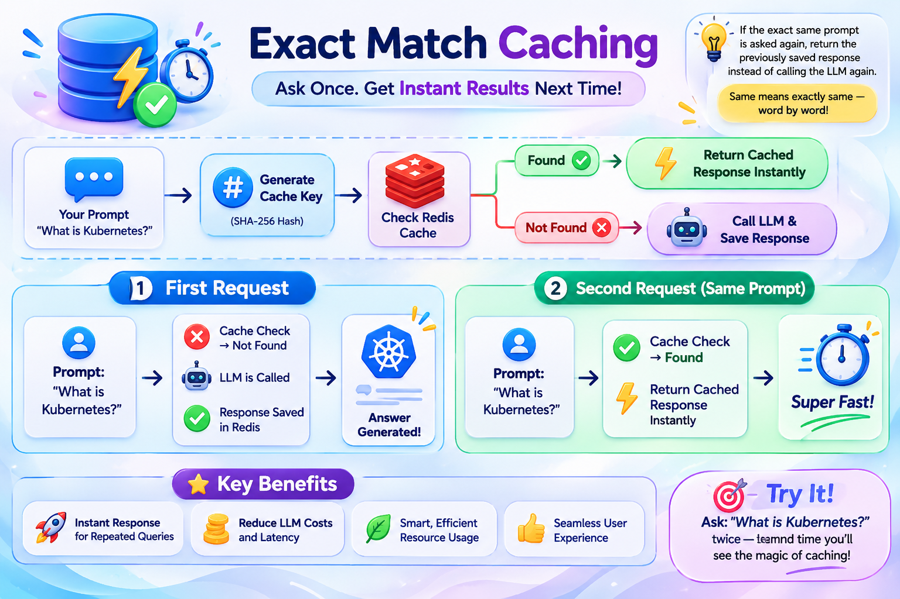
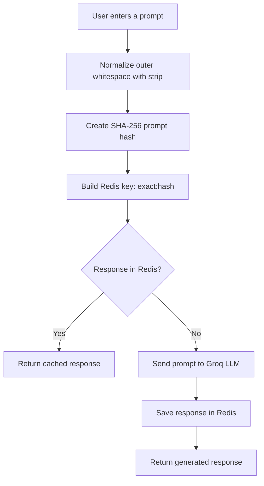

# Exact-Match Redis Caching for LLM Applications





> A small, practical example of caching LLM responses with Redis to avoid repeated API calls for identical prompts.

[](https://www.python.org/)
[](https://redis.io/)
[](https://groq.com/)


## Overview

This project demonstrates **exact-match caching**, also known as a cache-aside pattern for repeated LLM requests.

When a user enters a prompt, the application:

1. Creates a deterministic SHA-256 hash of the prompt.

1. Uses the hash to build a Redis key in the form `exact:<prompt_hash>`.

1. Checks Redis for an existing response.

1. Returns the cached response when the key exists.

1. Calls the Groq LLM only when the key is missing.

1. Stores the new response in Redis for future identical requests.

The result is a simple way to reduce unnecessary model calls, lower latency for repeated prompts, and save API usage.

## How It Works



The project also includes an architecture diagram in [`diagram.png`](./diagram.png).

## Project Structure

```
project_1_exact_match/
├── diagram.png   # Request and caching flow diagram
├── main.py       # Interactive Redis + Groq caching application
└── README.md     # Project documentation
```

## Requirements

- Python 3.9 or newer

- Redis 7 or newer running locally on port `6379`

- A Groq API key

- Internet access for the first request for a new prompt

## Installation

### 1. Clone the repository

```bash
git clone https://github.com/paras160500/Types-of-Redis-Caching-in-LLM.git
cd Types-of-Redis-Caching-in-LLM/project_1_exact_match
```

### 2. Create and activate a virtual environment

#### macOS/Linux

```bash
python3 -m venv .venv
source .venv/bin/activate
```

#### Windows PowerShell

```
python -m venv .venv
.venv\Scripts\Activate.ps1
```

### 3. Install Python dependencies

```bash
pip install redis python-dotenv groq
```

### 4. Start Redis

If Redis is installed locally, start the Redis server using your operating system's standard command.

Alternatively, run Redis with Docker:

```bash
docker run --name exact-match-redis -p 6379:6379 -d redis:7-alpine
```

Verify that Redis is available:

```bash
redis-cli ping
```

Expected output:

```
PONG
```

### 5. Configure the Groq API key

Create a `.env` file inside `project_1_exact_match`:

```
GROQ_API_KEY=your_groq_api_key_here
```

Do not commit `.env` or expose your API key in source code. Add it to `.gitignore` if needed:

```
.env
.venv/
__pycache__/
```

## Run the Example

From the `project_1_exact_match` directory, run:

```bash
python main.py
```

Enter a prompt at the `You:` input. To see a cache hit, submit the same prompt twice:

```
====== Exact Match Cache =======
Type a prompt (or exit to quit)

You: What is Kubernetes?

❌ CACHE MISS | Calling LLM
Saved to Cache (...) | Key: exact:...
Answer: ...

You: What is Kubernetes?

✔️ CACHE HIT (...) | Key exact:...
Answer: ...
```

Use `exit` or `quit` to stop the application.

## Example: Cache Key Generation

For every prompt, the application creates a fixed-length SHA-256 key:

```python
prompt_hash = hashlib.sha256(prompt.encode("utf-8")).hexdigest()
key = f"exact:{prompt_hash}"
```

This keeps Redis keys predictable in structure while avoiding the need to store the full prompt inside the key.

## What Counts as an Exact Match?

The application removes leading and trailing whitespace with `.strip()` before processing the input. Apart from that, matching is exact and case-sensitive.

These prompts are treated as different cache entries:

```
What is Redis?
what is redis?
What is Redis caching?
```

These prompts resolve to the same cache entry because surrounding whitespace is removed:

```
What is Redis?
  What is Redis?  
```

## Cache Behavior

This example intentionally keeps the caching logic simple:

- **Cache hit:** Redis returns the saved answer and the LLM is not called.

- **Cache miss:** The prompt is sent to Groq, then the response is saved in Redis.

- **Key format:** `exact:<sha256_hash>`.

- **Serialization:** Responses are stored as plain text using Redis `decode_responses=True`.

- **Expiration:** No TTL is currently configured, so entries remain until they are deleted or Redis evicts them according to its configuration.

- **Invalidation:** There is no automatic invalidation in this demo.

For production use, consider adding a TTL, a model/version namespace, prompt normalization, structured metadata, error handling, and observability.

## Technology Stack

- **Python** — application logic and interactive CLI

- **Redis** — low-latency response cache

- **Groq Python SDK** — LLM API client

- **python-dotenv** — loads `GROQ_API_KEY` from `.env`

- **SHA-256** — deterministic cache-key generation

## Troubleshooting

### `redis.exceptions.ConnectionError`

Redis is not running or is not listening on `localhost:6379`. Start Redis or confirm the Docker container is running:

```bash
docker ps
redis-cli ping
```

### `GROQ_API_KEY` is missing

Check that the `.env` file is located in the directory from which the script is launched and contains:

```
GROQ_API_KEY=your_groq_api_key_here
```

Also verify that the key is valid and has access to the configured model.

### The second request is still a cache miss

Exact-match caching requires the prompt to be the same after outer whitespace is removed. Differences in capitalization, punctuation, spelling, or internal spacing create different keys.

You can inspect cached keys from the Redis CLI:

```bash
redis-cli --scan --pattern 'exact:*'
```

## Limitations and Next Steps

This project is designed for learning and demonstration. A production-ready implementation would typically add:

- TTL-based expiration, for example `cache.setex(...)`.

- Cache invalidation when prompts, system instructions, or model versions change.

- A namespace containing the model and prompt-template version.

- Connection configuration through environment variables instead of hard-coded Redis settings.

- Retry and timeout handling for Redis and the LLM provider.

- Metrics such as hit rate, miss rate, latency, and token savings.

- Semantic caching for prompts that are similar but not textually identical.

- Protection against storing sensitive or personally identifiable information.

## Related Project

This directory is the first example in the repository's collection of Redis caching approaches for LLM applications. See the [repository home page](https://github.com/paras160500/Types-of-Redis-Caching-in-LLM) for additional projects as they are added.

## License

No license file is currently included in the repository. If you plan to reuse or distribute this project, add a license that reflects your intended terms.

## Acknowledgements

- [Redis](https://redis.io/) for the in-memory data store.

- [Groq](https://groq.com/) for the LLM API used by the example.