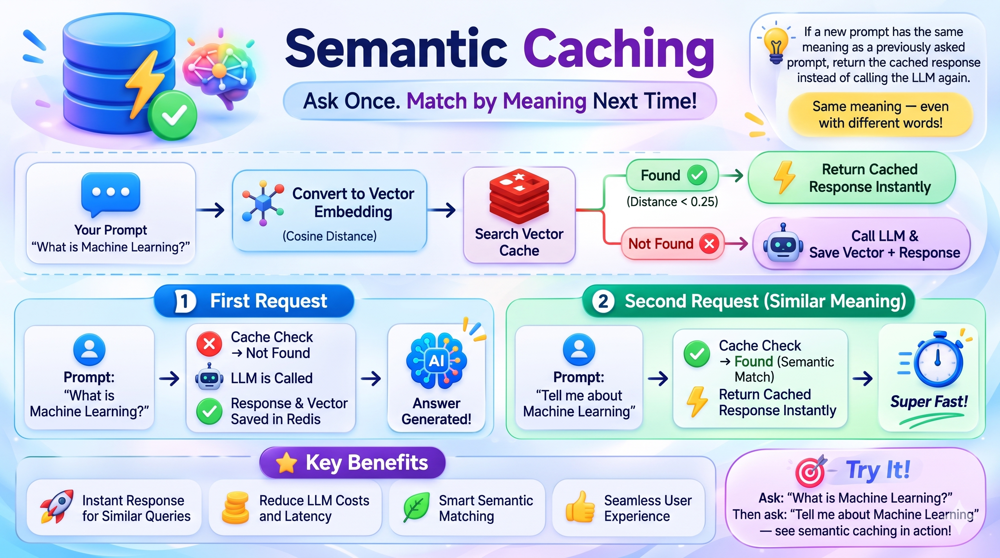
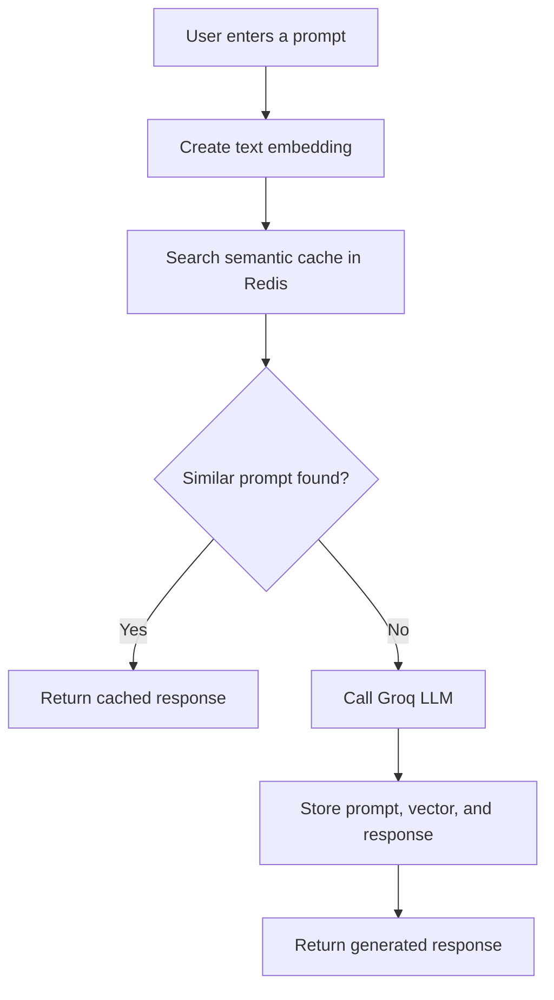

# Semantic Redis Caching for LLM Applications




> Reuse LLM responses for prompts with similar meaning—not only prompts with identical wording.

[](https://www.python.org/)
[](https://redis.io/)
[](https://redis.io/docs/latest/develop/ai/redisvl/)
[](https://groq.com/)

## Overview

This project demonstrates **semantic caching** for LLM applications using Redis, RedisVL, and a local sentence-embedding model.

Traditional exact-match caching only works when a user submits the same text again. Semantic caching goes one step further: it converts prompts into vectors and searches for a previously cached prompt with a sufficiently similar meaning.

For example, these prompts may be considered semantically related:

```
What is Machine Learning?
Can you explain how ML works?
```

If the similarity threshold is satisfied, the application returns the stored response and avoids another LLM request.

## How It Works



The project also includes a visual architecture diagram in [`diagram.png`](./diagram.png).

## Project Structure

```
project_2_semantic_match/
├── diagram.png   # Semantic caching architecture diagram
├── main.py       # Interactive Redis semantic-cache application
└── README.md     # Project documentation
```

## Requirements

- Python 3.9 or newer

- Redis 7 or newer running locally on port `6379`

- A Groq API key

- Internet access on the first run so the embedding model can be downloaded

- Enough local disk space for the Hugging Face embedding model and its dependencies

## Technology Stack

- **Python** — application logic and interactive CLI

- **Redis** — vector-backed semantic cache

- **RedisVL** — semantic cache abstraction and vector search integration

- **Hugging Face / Sentence Transformers** — local prompt embeddings

- **`all-MiniLM-L6-v2`** — sentence and short-paragraph embedding model

- **Groq Python SDK** — LLM API client

- **python-dotenv** — loads the API key from `.env`

The selected embedding model maps sentences and short paragraphs into a 384-dimensional vector space. The application loads it locally and prints a message because the first run downloads the model, approximately 90 MB according to the source code.

## Installation

### 1. Clone the repository

```bash
git clone https://github.com/paras160500/Types-of-Redis-Caching-in-LLM.git
cd Types-of-Redis-Caching-in-LLM/project_2_semantic_match
```

### 2. Create and activate a virtual environment

#### macOS/Linux

```bash
python3 -m venv .venv
source .venv/bin/activate
```

#### Windows PowerShell

```
python -m venv .venv
.venv\Scripts\Activate.ps1
```

### 3. Install dependencies

```bash
pip install redisvl python-dotenv groq
```

If your environment does not install the sentence-transformers dependencies automatically, install them explicitly:

```bash
pip install sentence-transformers
```

### 4. Start Redis

If Redis is installed locally, start the Redis server using your operating system's standard command.

Alternatively, run Redis with Docker:

```bash
docker run --name semantic-cache-redis -p 6379:6379 -d redis:7-alpine
```

Verify the connection:

```bash
redis-cli ping
```

Expected output:

```
PONG
```

### 5. Configure the Groq API key

Create a `.env` file inside `project_2_semantic_match`:

```
GROQ_API_KEY=your_groq_api_key_here
```

Never commit your API key. Add the following entries to `.gitignore` if they are not already present:

```
.env
.venv/
__pycache__/
```

## Run the Application

From the `project_2_semantic_match` directory, run:

```bash
python main.py
```

The application loads the local embedding model and starts an interactive prompt:

```
=== Project 2: Semantic Cache ===
Type 'clear' to wipe cache, or 'exit' to quit.
```

Try two prompts with similar meaning:

```
You: What is Machine Learning?

❌ CACHE MISS | Calling LLM...
💾 SAVED TO SEMANTIC CACHE (... ms)
Answer: ...

You: Can you explain how ML works?

✅ SEMANTIC HIT (... ms)
  Matched stored prompt: 'What is Machine Learning?' (distance: ...)
Answer: ...
```

Use the following commands during the session:

```
clear   # Delete all entries in the semantic cache
exit    # Quit the application
quit    # Quit the application
```

## Configuration

The semantic cache is initialized in `main.py` with these settings:

```python
semantic_cache = SemanticCache(
    name="semantic_demo",
    redis_url="redis://localhost:6379",
    distance_threshold=0.25,
    vectorizer=vectorizer,
)
```

### Distance threshold

The `distance_threshold` controls how close a stored prompt must be to the new prompt before it can be used as a cache hit.

- A lower threshold is more conservative and usually requires closer semantic matches.

- A higher threshold accepts broader relationships but increases the risk of returning an answer that is not precise enough for the new question.

- This project uses `0.25` as a demonstration value.

The ideal threshold depends on the application, embedding model, prompt domain, and the cost of an incorrect cache hit. Test it with representative prompts before using it in production.

### Embedding model

The project uses:

```python
HFTextVectorizer(model="sentence-transformers/all-MiniLM-L6-v2")
```

This model runs locally, so prompt embeddings do not require an additional hosted embedding API call. The model is intended for sentence and short-paragraph encoding, semantic search, clustering, and similarity tasks.

### LLM model

The example sends cache-miss prompts to the Groq model configured in the source code:

```python
MODEL = "openai/gpt-oss-20b"
```

Change this value only to a model available to your Groq account and API configuration.

## Semantic Cache Lifecycle

For every prompt, the application performs the following sequence:

1. The prompt is converted into an embedding vector by the local vectorizer.

1. RedisVL searches the Redis semantic cache for the nearest stored prompt.

1. If the result is within the configured distance threshold, the cached answer is returned.

1. If no acceptable match exists, the prompt is sent to the Groq LLM.

1. The original prompt, its vector representation, and the generated answer are stored in Redis.

Unlike exact-match caching, this approach can reuse answers for paraphrased or conceptually similar prompts. That improves cache coverage but requires more careful threshold tuning.

## Clearing the Cache

The CLI supports clearing the semantic cache:

```
You: clear
🧹 Semantic cache cleared!
```

You can also inspect Redis from a terminal:

```bash
redis-cli keys '*semantic*'
```

For production Redis deployments, prefer `SCAN`-based inspection over `KEYS` for large datasets.

## Troubleshooting

### Redis connection error

If the application cannot connect to Redis, confirm that Redis is running on `localhost:6379`:

```bash
redis-cli ping
docker ps
```

If Redis runs elsewhere, update the `redis_url` in `main.py` or make it configurable through an environment variable.

### The first run is slow

The application downloads and initializes the local embedding model the first time it runs. Later runs can use the local model cache, so startup is normally faster.

### `GROQ_API_KEY` is missing

Check that `.env` is in the directory from which the script is launched and contains:

```
GROQ_API_KEY=your_groq_api_key_here
```

Also confirm that the key is valid and that the configured model is available to your account.

### Similar questions are not producing a semantic hit

The prompts may be outside the configured `0.25` distance threshold. Try a smaller wording change first, then adjust the threshold carefully. A threshold that is too low produces more misses; a threshold that is too high can produce incorrect matches.

### An unrelated prompt returns a cached answer

The threshold may be too permissive for your use case. Lower it, evaluate the results with a test set, or add application-specific validation before returning a cached response.

## Limitations and Production Considerations

This is a learning project that demonstrates the core semantic-cache workflow. A production implementation should also consider:

- TTL-based expiration so answers do not remain indefinitely.

- Cache namespaces containing the model name, system prompt version, and application version.

- Prompt normalization and metadata filters for tenant, user, language, or product area.

- Evaluation datasets for measuring semantic-hit precision and false-positive rate.

- Different thresholds for different question types.

- Retry, timeout, and fallback handling for Redis, model loading, and LLM requests.

- Metrics for cache-hit rate, cache-miss rate, latency, token savings, and incorrect matches.

- Privacy controls and encryption policies for sensitive prompts and responses.

- A persistent or managed Redis deployment for applications that must survive process restarts.

- A strategy for embedding-model upgrades, because vectors generated by different models may not be compatible.

Semantic caching should not be enabled blindly for requests where a small change in wording can change the correct answer, such as account-specific, time-sensitive, transactional, or safety-critical questions.

## Exact Match vs. Semantic Match

This repository also contains an exact-match example. The difference is:

- **Exact match:** the same prompt text maps to the same deterministic cache key.

- **Semantic match:** prompts are embedded as vectors and matched by meaning within a configured distance threshold.

Exact matching is simpler and more predictable. Semantic matching can achieve a higher hit rate for paraphrased prompts, but it needs an embedding model and careful quality evaluation.

## Related Project

See the [exact-match caching project](../project_1_exact_match) to compare deterministic prompt hashing with semantic vector matching.

The repository home page contains the broader collection of Redis caching examples for LLM applications:

[Types of Redis Caching in LLM](https://github.com/paras160500/Types-of-Redis-Caching-in-LLM)

## License

No license file is currently included in the repository. Add a license if you plan to reuse or distribute this project.

## Acknowledgements

- [Redis](https://redis.io/) for the in-memory data store and vector-search foundation.

- [RedisVL](https://redis.io/docs/latest/develop/ai/redisvl/) for the semantic-cache abstraction.

- [Sentence Transformers](https://www.sbert.net/) and [Hugging Face](https://huggingface.co/) for the local embedding model ecosystem.

- [Groq](https://groq.com/) for the LLM API used by the example.