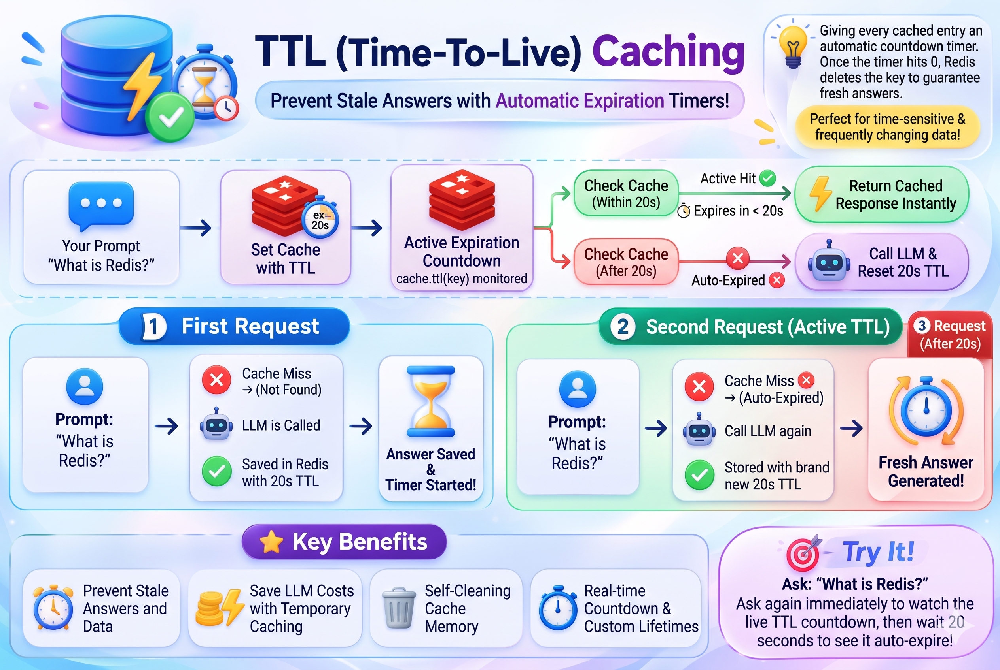
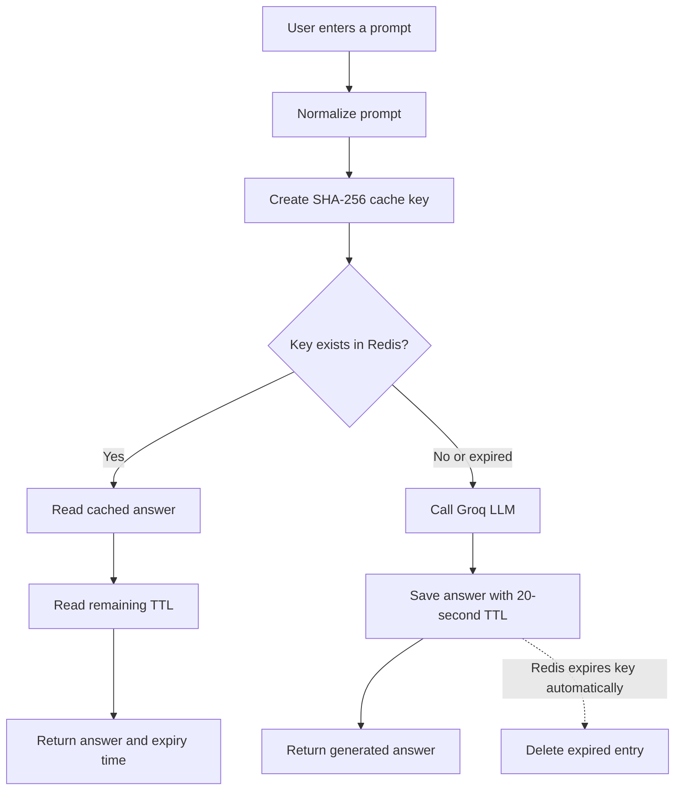

# TTL-Based Redis Caching for LLM Applications




> Automatically expire cached LLM responses after a fixed amount of time with Redis TTLs.

[](https://www.python.org/)
[](https://redis.io/)
[](https://groq.com/)

## Overview

This project demonstrates how to add **time-to-live (TTL)** expiration to an LLM response cache using Redis.

A cached answer should not always live forever. Information can become outdated, model behavior can change, and application data may need to be refreshed periodically. Redis TTLs solve this by attaching an expiration timer to each cache entry.

This example uses a short **20-second TTL** so the complete cache lifecycle can be observed interactively:

1. The first request is a cache miss and calls the Groq LLM.

1. The response is saved in Redis with a 20-second expiration.

1. Repeating the request before expiration produces a cache hit.

1. After 20 seconds, Redis automatically removes the key.

1. The next request becomes a cache miss and generates a fresh response.

## How It Works



The project also includes an architecture diagram in [`diagram.png`](./diagram.png).

## Project Structure

```
project_3_ttl_cache/
├── diagram.png   # TTL-cache architecture diagram
├── main.py       # Interactive Redis TTL-cache application
└── README.md     # Project documentation
```

## Requirements

- Python 3.9 or newer

- Redis 7 or newer running locally on port `6379`

- A Groq API key

- Internet access for LLM requests

## Installation

### 1. Clone the repository

```bash
git clone https://github.com/paras160500/Types-of-Redis-Caching-in-LLM.git
cd Types-of-Redis-Caching-in-LLM/project_3_ttl_cache
```

### 2. Create and activate a virtual environment

#### macOS/Linux

```bash
python3 -m venv .venv
source .venv/bin/activate
```

#### Windows PowerShell

```
python -m venv .venv
.venv\Scripts\Activate.ps1
```

### 3. Install Python dependencies

```bash
pip install redis python-dotenv groq
```

### 4. Start Redis

If Redis is installed locally, start the Redis server using your operating system's standard command.

Alternatively, run Redis with Docker:

```bash
docker run --name ttl-cache-redis -p 6379:6379 -d redis:7-alpine
```

Verify the connection:

```bash
redis-cli ping
```

Expected output:

```
PONG
```

### 5. Configure the Groq API key

Create a `.env` file inside `project_3_ttl_cache`:

```
GROQ_API_KEY=your_groq_api_key_here
```

Keep credentials out of source control. Add the following entries to `.gitignore` if needed:

```
.env
.venv/
__pycache__/
```

## Run the Example

From the `project_3_ttl_cache` directory, run:

```bash
python main.py
```

Then follow the demo flow:

```
You: What is Redis?

❌ CACHE MISS (Not found or expired) | Calling LLM...
💾 SAVED WITH 20s TTL (... ms)
Answer: ...

You: What is Redis?

✅ CACHE HIT (... ms) | ⏳ Expires in: 17s
Answer: ...
```

Wait for the 20-second TTL to expire and submit the same prompt again:

```
You: What is Redis?

❌ CACHE MISS (Not found or expired) | Calling LLM...
💾 SAVED WITH 20s TTL (... ms)
Answer: ...
```

Use `exit` or `quit` to stop the application.

## Cache Key Normalization

Before generating the cache key, the application normalizes the prompt:

```python
normalized = prompt.lower().strip()
prompt_hash = hashlib.sha256(normalized.encode("utf-8")).hexdigest()
key = f"ttl:{prompt_hash}"
```

This means the following prompts use the same cache key:

```
What is Redis?
what is redis?
  What is Redis?  
```

The normalization is case-insensitive and removes leading and trailing whitespace. Internal spacing, punctuation, and wording are not otherwise changed.

## TTL Implementation

The response is stored with an expiration time using Redis `SET` with the `ex` argument:

```python
cache.set(key, answer, ex=TTL_SECONDS)
```

The project sets:

```python
TTL_SECONDS = 20
```

On a cache hit, the remaining lifetime is read with:

```python
seconds_left = cache.ttl(key)
```

Redis automatically removes the key after the TTL reaches zero. The application does not need a separate cleanup job for these expired entries.

## Redis Commands for Inspection

List TTL-cache keys:

```bash
redis-cli --scan --pattern 'ttl:*'
```

Check the remaining lifetime of a specific key:

```bash
redis-cli TTL 'ttl:<sha256_hash>'
```

Redis TTL results have the following meaning:

- A non-negative integer represents the remaining lifetime in seconds.

- `-1` means the key exists without an expiration.

- `-2` means the key does not exist, usually because it expired or was deleted.

## Choosing a TTL

The 20-second value is intentionally short for demonstration. In a real application, choose a TTL based on how quickly the answer can become stale.

Examples:

- **Seconds or minutes:** rapidly changing data, live status, temporary experiments

- **Hours:** frequently updated product or operational information

- **Days:** stable FAQs, documentation, or general educational answers

- **No expiration:** only when the data is intentionally permanent and invalidation is handled separately

A shorter TTL reduces stale responses but creates more LLM requests. A longer TTL improves cache reuse but increases the chance that an answer is out of date.

## Configuration

To change the expiration duration, edit `TTL_SECONDS` in `main.py`:

```python
TTL_SECONDS = 60
```

This changes the lifetime of newly stored responses. Existing Redis keys keep the TTL that was assigned when they were created.

The example also connects to a local Redis instance and uses the following LLM model:

```python
cache = redis.Redis(
    host="localhost",
    port=6379,
    decode_responses=True,
)

MODEL = "openai/gpt-oss-20b"
```

For a deployed application, make the Redis URL, host, port, TTL, and model configurable through environment variables rather than hard-coding them.

## TTL Cache vs. Other Cache Strategies

This repository contains multiple caching examples:

- **Exact match:** reuses a response only for the same prompt text.

- **Semantic match:** reuses a response for prompts with similar meaning.

- **TTL cache:** adds automatic expiration so cached responses are refreshed over time.

TTL is not necessarily a replacement for exact or semantic matching. It is an expiration policy that can be combined with either approach.

For example, a production application could use semantic matching to find related prompts and a TTL to ensure that old answers are eventually refreshed.

## Troubleshooting

### Redis connection error

Redis is not running or is not listening on `localhost:6379`. Check the service and test the connection:

```bash
docker ps
redis-cli ping
```

### The prompt always produces a cache miss

The key may have already expired. Check the configured `TTL_SECONDS` value and submit the same prompt again immediately after a miss.

Remember that changes to capitalization or leading/trailing whitespace are normalized, but changes to wording, punctuation, or internal spacing can produce a different key.

### `GROQ_API_KEY` is missing

Confirm that `.env` is in the project directory and contains:

```
GROQ_API_KEY=your_groq_api_key_here
```

Also verify that the API key is valid and that the configured model is available to your account.

### The cached response is still available after the TTL

Redis expiration is handled by Redis, but expiration timing is not intended to be a precise real-time scheduler. Check the key with `TTL` and ensure that you are connected to the same Redis instance used by the application.

## Limitations and Production Considerations

This project is designed for learning and demonstration. A production implementation should also consider:

- Selecting TTLs based on data freshness requirements.

- Adding cache namespaces for model version, system prompt version, and application version.

- Handling Redis and LLM timeouts, retries, and temporary failures.

- Measuring hit rate, miss rate, expiry rate, latency, and token savings.

- Avoiding caching sensitive or user-specific responses under shared keys.

- Including tenant, user, language, or authorization context when responses are not globally reusable.

- Using a managed or persistent Redis deployment when cache availability matters.

- Planning invalidation for events that make cached answers stale before the TTL expires.

- Reviewing response quality after cache hits, especially for dynamic or safety-sensitive questions.

- Making the TTL configurable without requiring a code change.

A TTL limits how long an answer remains available, but it does not guarantee that the answer is correct during that period. Use explicit invalidation for events that require immediate freshness.

## Related Projects

- [Exact-match Redis caching](../project_1_exact_match)

- [Semantic Redis caching](../project_2_semantic_match)

- [Repository home page](https://github.com/paras160500/Types-of-Redis-Caching-in-LLM)

## License

No license file is currently included in the repository. Add a license if you plan to reuse or distribute this project.

## Acknowledgements

- [Redis](https://redis.io/) for the in-memory data store and expiration support.

- [Groq](https://groq.com/) for the LLM API used by the example.