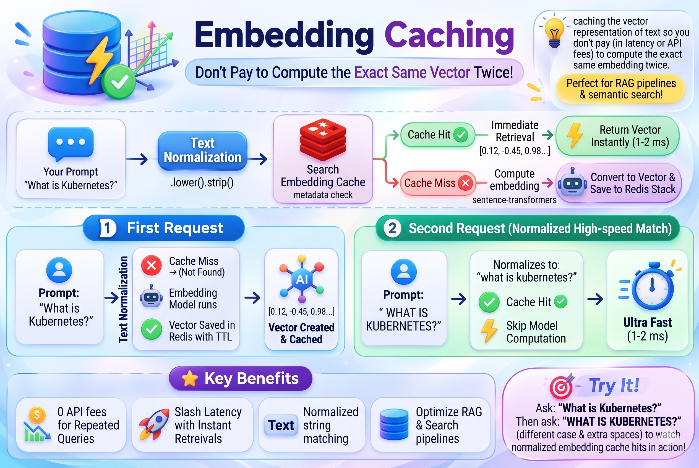
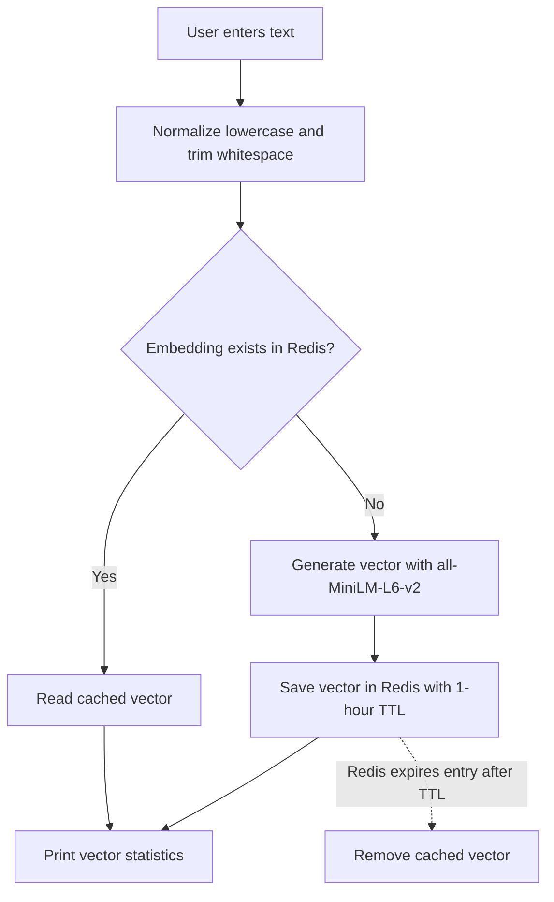

# Embedding Cache with Redis and RedisVL




> Cache locally generated text embeddings in Redis so repeated inputs do not need to be embedded again.

[](https://www.python.org/)
[](https://redis.io/)
[](https://redis.io/docs/latest/develop/ai/redisvl/)
[](https://huggingface.co/sentence-transformers/all-MiniLM-L6-v2)

## Overview

This project demonstrates how to cache **text embeddings** with Redis and RedisVL.

An embedding model converts text into a numerical vector that represents the text's meaning. Generating embeddings repeatedly can consume CPU, increase latency, and become expensive when an application processes the same text more than once.

This example stores generated vectors in Redis for one hour. When the same normalized text is submitted again, RedisVL reuses the cached vector instead of computing it again with the local embedding model.

> This project caches embeddings only. It does not call an LLM and it does not cache LLM responses.

## How It Works



The project also includes a visual architecture diagram in [`diagram.png`](./diagram.png).

## Project Structure

```
project_4_embedding_cache/
├── diagram.png   # Embedding-cache architecture diagram
├── main.py       # Interactive embedding-cache application
└── README.md     # Project documentation
```

## Requirements

- Python 3.9 or newer

- Redis 7 or newer running locally on port `6379`

- Internet access on the first run to download the embedding model

- Enough local storage and memory for the embedding model and its dependencies

No Groq API key is required because this project does not make LLM requests.

## Technology Stack

- **Python** — application logic and interactive CLI

- **Redis** — storage for cached embedding vectors

- **RedisVL** — `EmbeddingsCache` and vectorizer integration

- **Hugging Face Sentence Transformers** — local embedding model

- **`sentence-transformers/all-MiniLM-L6-v2`** — text embedding model

The selected model maps sentences and short paragraphs into a 384-dimensional vector space. The program prints the vector length and the first five values so the cache behavior can be observed without dumping the complete vector to the terminal.

## Installation

### 1. Clone the repository

```bash
git clone https://github.com/paras160500/Types-of-Redis-Caching-in-LLM.git
cd Types-of-Redis-Caching-in-LLM/project_4_embedding_cache
```

### 2. Create and activate a virtual environment

#### macOS/Linux

```bash
python3 -m venv .venv
source .venv/bin/activate
```

#### Windows PowerShell

```
python -m venv .venv
.venv\Scripts\Activate.ps1
```

### 3. Install dependencies

```bash
pip install redisvl sentence-transformers
```

If your environment resolves the embedding dependencies through RedisVL, the explicit `sentence-transformers` installation is still safe and makes the model dependency clear.

### 4. Start Redis

If Redis is installed locally, start the Redis server using your operating system's standard command.

Alternatively, run Redis with Docker:

```bash
docker run --name embedding-cache-redis -p 6379:6379 -d redis:7-alpine
```

Verify the connection:

```bash
redis-cli ping
```

Expected output:

```
PONG
```

## Run the Example

From the `project_4_embedding_cache` directory, run:

```bash
python main.py
```

The application loads the local embedding model and starts an interactive prompt:

```
=== Project 4: Embedding Cache (No LLM Needed) ===
Type 'clear' to wipe cached vectors, or 'exit' to quit.
```

Try the same text with different capitalization and surrounding whitespace:

```
Text to embed: What is Kubernetes?

❌ EMBEDDING CACHE MISS (Computed & Saved) (... ms)
  Normalized text: 'what is kubernetes?'
  Vector dims: 384
  First 5 values: [...]

Text to embed:  WHAT IS KUBERNETES? 

✅ EMBEDDING CACHE HIT (... ms)
  Normalized text: 'what is kubernetes?'
  Vector dims: 384
  First 5 values: [...]
```

Use the following commands:

```
clear   # Remove all cached embeddings
exit    # Quit the application
quit    # Quit the application
```

## Embedding Cache Configuration

The cache is configured in `main.py` as follows:

```python
embed_cache = EmbeddingsCache(
    name="embed_demo",
    redis_url="redis://localhost:6379",
    ttl=3600,
)
```

The current TTL is `3600` seconds, which equals one hour. Existing entries expire automatically after their one-hour lifetime.

The vectorizer is connected directly to the cache:

```python
vectorizer = HFTextVectorizer(
    model=MODEL_NAME,
    cache=embed_cache,
)
```

When `vectorizer.embed(...)` is called, RedisVL checks the embedding cache first. If the normalized content and model combination is already cached, the stored vector is reused. Otherwise, the model computes a new vector and RedisVL saves it.

## Text Normalization

Before checking or generating an embedding, the application normalizes input text:

```python
normalized_prompt = raw_prompt.lower().strip()
```

This means the following inputs share the same cached vector:

```
What is Kubernetes?
what is kubernetes?
  WHAT IS KUBERNETES?  
```

The normalization is case-insensitive and removes leading and trailing whitespace. Internal spacing, punctuation, and wording are not otherwise changed.

## Cache Identity

The cache checks whether an embedding exists using both the normalized content and the configured model name:

```python
embed_cache.exists(
    content=normalized_prompt,
    model_name=MODEL_NAME,
)
```

Including the model name is important. The same text can produce different vectors when it is embedded with a different model, so vectors from different embedding models should not be treated as interchangeable.

## Inspecting Redis

List embedding-cache keys:

```bash
redis-cli --scan --pattern '*embed*'
```

Check the TTL of a specific key after finding it:

```bash
redis-cli TTL '<redis-key>'
```

The expected lifetime for newly saved entries is approximately 3600 seconds. The exact displayed value decreases as time passes.

For large Redis deployments, use `SCAN`-based inspection rather than `KEYS`, because `KEYS` can block Redis while scanning a large keyspace.

## Why Cache Embeddings?

Embedding caching is useful when an application repeatedly processes the same content. Common examples include:

- Search queries entered repeatedly by users

- Documents that are embedded during multiple workflows

- Frequently accessed product descriptions or support articles

- Repeated retrieval and recommendation requests

- Batch jobs that revisit the same text

- Applications that use embeddings for classification, clustering, or similarity search

The cache avoids repeating the embedding computation while preserving the vector for downstream use.

## Embedding Cache vs. Semantic Response Cache

These are related but different strategies:

| Strategy | What is cached? | How is it reused? |
| --- | --- | --- |
| Embedding cache | The numerical vector for input text | The same normalized content can reuse its vector |
| Semantic response cache | A prompt and its generated LLM response | A sufficiently similar prompt can reuse the answer |
| Exact-match response cache | An LLM response | The same prompt key can reuse the answer |

This project implements the first strategy. It does not decide whether two different prompts are semantically similar, and it does not return a cached LLM answer.

## Troubleshooting

### Redis connection error

Redis is not running or is not listening on `localhost:6379`. Check the service and test the connection:

```bash
docker ps
redis-cli ping
```

### The first run is slow

The embedding model is downloaded and initialized on the first run. Later runs can use the local model cache and should start more quickly.

### The second input is still an embedding-cache miss

Check whether the normalized text is actually the same. Differences in wording, punctuation, or internal whitespace are not removed by the current normalization logic.

### The vector dimension is unexpected

The vector size depends on the selected embedding model. This project uses `all-MiniLM-L6-v2`, which produces 384-dimensional vectors. If you change the model, verify that downstream Redis indexes and consumers support the new dimension.

### `clear` does not behave as expected

The `clear` command clears the cache configured by the `EmbeddingsCache` instance. Confirm that the application and your Redis CLI are connected to the same Redis server and database.

## Limitations and Production Considerations

This is a learning project that demonstrates the basic embedding-cache lifecycle. A production implementation should also consider:

- Making the Redis URL, cache name, model name, and TTL configurable through environment variables.

- Using a cache namespace that includes the embedding-model version.

- Planning a migration when changing embedding models or vector dimensions.

- Measuring embedding-cache hit rate, miss rate, latency, and storage usage.

- Adding retries and timeouts for Redis and model loading.

- Protecting sensitive text and considering encryption or access controls.

- Evaluating whether content normalization changes the intended meaning.

- Using a persistent or managed Redis deployment when cache availability matters.

- Choosing TTLs based on how often source content or embedding models change.

- Avoiding unbounded cache growth through TTLs, eviction policies, or explicit cleanup.

Caching a vector does not guarantee that the source text is current. If the underlying document changes, invalidate or version its embedding as well.

## Related Projects

- [Exact-match Redis caching](../project_1_exact_match)

- [Semantic Redis caching](../project_2_semantic_match)

- [TTL-based Redis caching](../project_3_ttl_cache)

- [Repository home page](https://github.com/paras160500/Types-of-Redis-Caching-in-LLM)

## License

No license file is currently included in the repository. Add a license if you plan to reuse or distribute this project.

## Acknowledgements

- [Redis](https://redis.io/) for the in-memory data store.

- [RedisVL](https://redis.io/docs/latest/develop/ai/redisvl/) for the embeddings-cache integration.

- [Hugging Face](https://huggingface.co/) and [Sentence Transformers](https://www.sbert.net/) for the embedding model ecosystem.