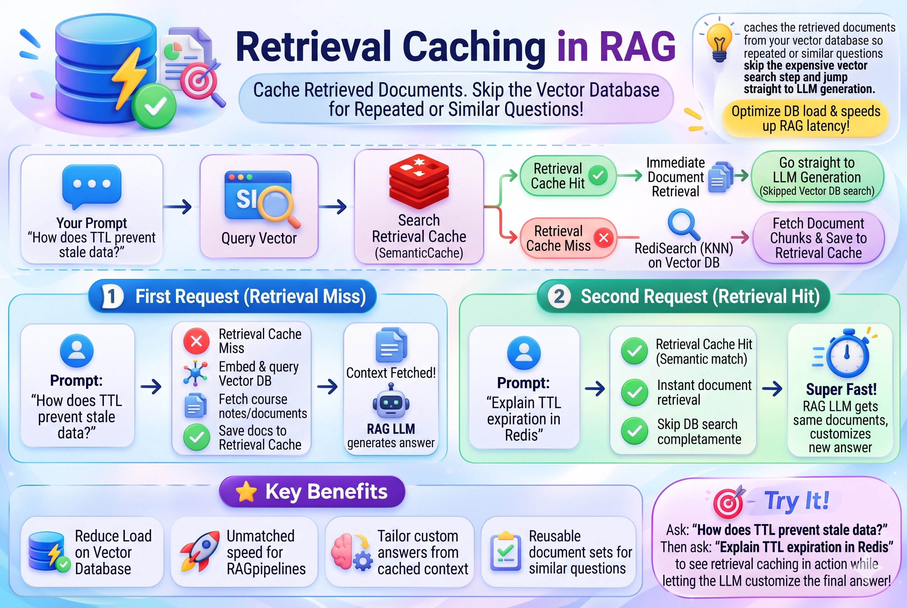
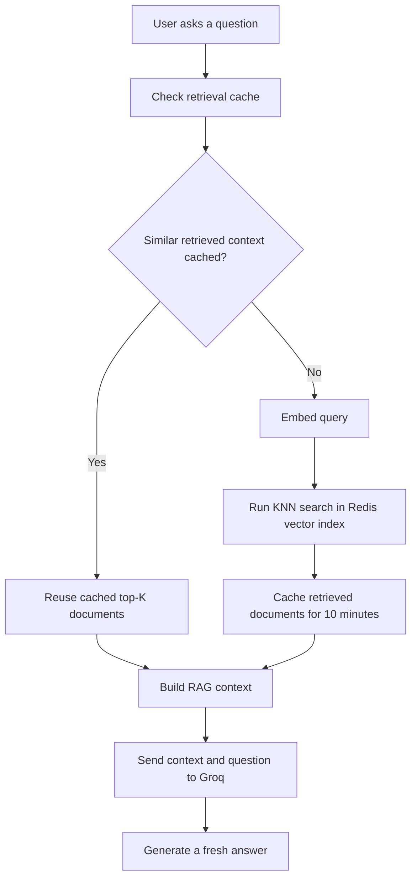

# Retrieval Cache for RAG Applications with Redis




> Cache retrieved knowledge-base context so repeated questions can skip vector-database searches while still generating a fresh LLM answer.

[](https://www.python.org/)
[](https://redis.io/)
[](https://redis.io/docs/latest/develop/ai/redisvl/)
[](https://groq.com/)

## Overview

This project demonstrates a **retrieval cache** inside a small Retrieval-Augmented Generation (RAG) pipeline.

In a typical RAG application, every user question is embedded and sent to a vector database to find relevant documents. That retrieval step can become repetitive and expensive when users ask similar questions. A retrieval cache stores the documents returned for a query, allowing future semantically similar queries to reuse the same context without searching the vector database again.

This example uses Redis for both the vector knowledge base and the retrieval cache:

- A small course-notes knowledge base is indexed in Redis.

- The query is embedded with `all-MiniLM-L6-v2`.

- Redis vector search returns the top two matching notes.

- The retrieved notes are stored in a semantic retrieval cache for 10 minutes.

- The cached notes are passed to Groq for a new answer on every request.

> Important: this project caches retrieved documents, not final LLM answers. The LLM is still called after every retrieval-cache hit so the answer can be generated for the current user question.

## Architecture



The project also includes a visual architecture diagram in [`diagram.png`](./diagram.png).

## Project Structure

```
project_5_retrieval_cache/
├── diagram.png   # Retrieval-cache and RAG architecture diagram
├── main.py       # Knowledge-base, retrieval cache, and RAG application
└── README.md     # Project documentation
```

## Requirements

- Python 3.9 or newer

- Redis 7 or newer with RediSearch/vector-search support

- A Groq API key

- Internet access on the first run to download the embedding model

- Enough local storage and memory for the embedding model and dependencies

## Technology Stack

- **Python** — application logic and interactive CLI

- **Redis** — vector database and retrieval-cache store

- **RedisVL** — Redis vector index, vector queries, and semantic cache abstraction

- **RediSearch** — K-nearest-neighbor vector search

- **Hugging Face Sentence Transformers** — local query and document embeddings

- **`sentence-transformers/all-MiniLM-L6-v2`** — 384-dimensional embedding model

- **Groq Python SDK** — LLM response generation

## Installation

### 1. Clone the repository

```bash
git clone https://github.com/paras160500/Types-of-Redis-Caching-in-LLM.git
cd Types-of-Redis-Caching-in-LLM/project_5_retrieval_cache
```

### 2. Create and activate a virtual environment

#### macOS/Linux

```bash
python3 -m venv .venv
source .venv/bin/activate
```

#### Windows PowerShell

```
python -m venv .venv
.venv\Scripts\Activate.ps1
```

### 3. Install dependencies

```bash
pip install redisvl python-dotenv groq sentence-transformers
```

### 4. Start Redis

The project uses Redis vector search. The Redis Stack image is recommended because it includes the search and vector capabilities needed by the example:

```bash
docker run --name retrieval-cache-redis -p 6379:6379 -d redis/redis-stack-server:latest
```

Verify that Redis is available:

```bash
redis-cli ping
```

Expected output:

```
PONG
```

### 5. Configure the Groq API key

Create a `.env` file inside `project_5_retrieval_cache`:

```
GROQ_API_KEY=your_groq_api_key_here
```

Do not commit `.env` or expose your API key. Add these entries to `.gitignore` if needed:

```
.env
.venv/
__pycache__/
```

## Run the Example

From the `project_5_retrieval_cache` directory, run:

```bash
python main.py
```

The program loads the local embedding model, creates the Redis vector index, inserts the sample course notes, and starts an interactive prompt.

Try the demonstration flow:

```
You: How does TTL prevent stale data?

🔍 Step 1: Fetching relevant context...
 ❌ RETRIEVAL CACHE MISS (...) -> Searched Vector DB & cached 2 docs.
🤖 Step 2: Sending cached/retrieved context + prompt to Groq LLM...
Answer: ...

You: Explain TTL expiration in Redis

🔍 Step 1: Fetching relevant context...
 ✅ RETRIEVAL CACHE HIT (...) -> Skipped Vector DB search!
🤖 Step 2: Sending cached/retrieved context + prompt to Groq LLM...
Answer: ...
```

On the second request, the vector-database search is skipped, but the Groq request still runs.

Use the following commands:

```
clear   # Clear the retrieval cache
exit    # Quit the application
quit    # Quit the application
```

## How the Knowledge Base Works

The example creates five short course notes covering the caching projects in the repository:

- Exact-match caching

- Semantic caching

- TTL caching

- Embedding caching

- Retrieval caching

Each note is stored in Redis as a hash with these fields:

- `topic` — a tag used to identify the note category

- `content` — the source text used as retrieved context

- `embedding` — the 384-dimensional vector generated by the local model

The Redis vector index is configured with:

```python
kb_schema = {
    "index": {
        "name": "course_notes_idx",
        "prefix": "note",
        "storage_type": "hash",
    },
    "fields": [
        {"name": "topic", "type": "tag"},
        {"name": "content", "type": "text"},
        {
            "name": "embedding",
            "type": "vector",
            "attrs": {
                "dims": 384,
                "distance_metric": "cosine",
                "algorithm": "flat",
                "datatype": "float32",
            },
        },
    ],
}
```

The index is recreated with `overwrite=True` each time the program starts, so the sample knowledge base is reset during startup.

## Retrieval Flow

The `retrieve_documents()` function follows three stages:

1. Check the retrieval cache for a semantically similar query.

1. On a cache miss, embed the query and run a KNN vector search against the Redis knowledge base.

1. Store the retrieved documents as a JSON response in the retrieval cache.

The current retrieval settings are:

```python
retrieval_cache = SemanticCache(
    name="retrieval_cache_demo",
    redis_url="redis://localhost:6379",
    distance_threshold=0.25,
    vectorizer=vectorizer,
    ttl=600,
)
```

The application requests the top two documents:

```python
docs = retrieve_documents(query, top_k=2)
```

The retrieved documents are then included in the system message sent to Groq:

```
Answer in 2 concise sentences using ONLY these notes:
- retrieved document 1
- retrieved document 2
```

## Retrieval Cache vs. Response Cache

A retrieval cache and a response cache improve different parts of an RAG pipeline:

| Cache type | What it stores | What it skips |
| --- | --- | --- |
| Retrieval cache | Retrieved document chunks | Vector-database search |
| Embedding cache | Text embedding vectors | Repeated embedding computation |
| Semantic response cache | Prompt and final answer | Retrieval and LLM generation, when safe |
| Exact response cache | Prompt-keyed final answer | LLM generation for identical prompts |

Retrieval caching is useful when you want to reduce database work while still generating a fresh, question-specific answer.

## Configuration

### Retrieval-cache TTL

The current retrieval-cache TTL is 600 seconds, or 10 minutes:

```python
ttl=600
```

Change this value to control how long retrieved document lists remain available. A shorter TTL refreshes retrieval results more often. A longer TTL improves reuse but may keep outdated context.

### Similarity threshold

The current `distance_threshold` is `0.25`:

- A lower threshold is more conservative and usually requires a closer query match.

- A higher threshold accepts broader semantic relationships but increases the risk of reusing the wrong document set.

Tune the threshold against representative questions from your application domain.

### Number of documents

The demo retrieves two documents by default:

```python
top_k=2
```

Increase or decrease `top_k` based on the quality of your knowledge base, context-window budget, and expected answer quality.

### LLM model

The example sends the retrieved context to the Groq model configured in the source code:

```python
MODEL = "openai/gpt-oss-20b"
```

Use a model that is available to your Groq account and appropriate for your application.

## Inspecting Redis

List keys created for the knowledge base or retrieval cache:

```bash
redis-cli --scan --pattern 'note*'
redis-cli --scan --pattern '*retrieval*'
```

For large Redis deployments, prefer `SCAN`-based inspection over `KEYS` because `KEYS` can block Redis while scanning a large keyspace.

Inspect the Redis search index:

```bash
redis-cli FT._LIST
```

The knowledge-base index created by the project is named:

```
course_notes_idx
```

## Troubleshooting

### Redis vector search is unavailable

A basic Redis installation may not include the RediSearch/vector-search capabilities required by `SearchIndex` and `VectorQuery`. Run Redis Stack instead:

```bash
docker run --name retrieval-cache-redis -p 6379:6379 -d redis/redis-stack-server:latest
```

### Redis connection error

Check that the Redis container is running and accessible:

```bash
docker ps
redis-cli ping
```

### The first run is slow

The local embedding model is downloaded and initialized on the first run. Later runs can use the local model cache and should start faster.

### The retrieval cache is not producing a hit

The query may be outside the configured `0.25` semantic-distance threshold. Try a closer paraphrase first, then tune the threshold using representative test questions.

### The answer does not use the expected information

Inspect the printed `Doc 1` and `Doc 2` values. The LLM receives only those retrieved notes. If the wrong notes are returned, improve the source chunks, embedding model, index configuration, threshold, or `top_k` value.

### The cache appears empty after restarting

The knowledge base is rebuilt at startup, and the retrieval cache may contain only entries from the current or previous Redis session. Also remember that retrieval entries expire after 10 minutes.

## Limitations and Production Considerations

This is a compact educational RAG example. A production implementation should also consider:

- Replacing the five hard-coded notes with a document ingestion pipeline.

- Chunking large documents with stable IDs and source metadata.

- Adding filters for tenant, language, product, permissions, or document version.

- Using a model and vector dimension appropriate for the target language and domain.

- Handling embedding-model upgrades and index migrations.

- Measuring retrieval precision, cache-hit rate, cache-miss rate, latency, and answer quality.

- Invalidating cached retrieval results when source documents change.

- Adding Redis and LLM retries, timeouts, and fallback behavior.

- Preventing sensitive or unauthorized context from being reused across users.

- Making Redis URL, model name, TTL, threshold, and `top_k` configurable.

- Evaluating whether a retrieval-cache hit remains valid for the current user question.

- Protecting against prompt injection in retrieved documents.

A retrieval-cache hit only means that a similar query found a previously retrieved document set. It does not prove that the cached documents are the best context for every new question.

## Related Projects

- [Exact-match Redis caching](../project_1_exact_match)

- [Semantic Redis caching](../project_2_semantic_match)

- [TTL-based Redis caching](../project_3_ttl_cache)

- [Embedding caching](../project_4_embedding_cache)

- [Repository home page](https://github.com/paras160500/Types-of-Redis-Caching-in-LLM)

## License

No license file is currently included in the repository. Add a license if you plan to reuse or distribute this project.

## Acknowledgements

- [Redis](https://redis.io/) for the data store and vector-search foundation.

- [RedisVL](https://redis.io/docs/latest/develop/ai/redisvl/) for Redis vector indexing and cache integrations.

- [Hugging Face](https://huggingface.co/) and [Sentence Transformers](https://www.sbert.net/) for the embedding model ecosystem.

- [Groq](https://groq.com/) for the LLM API used in the RAG response step.