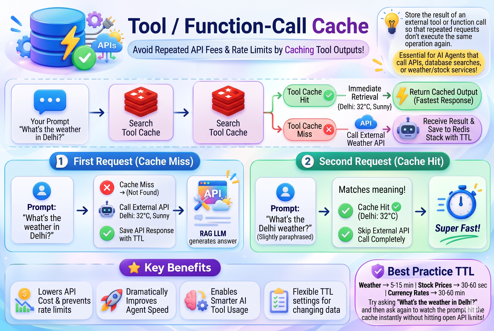
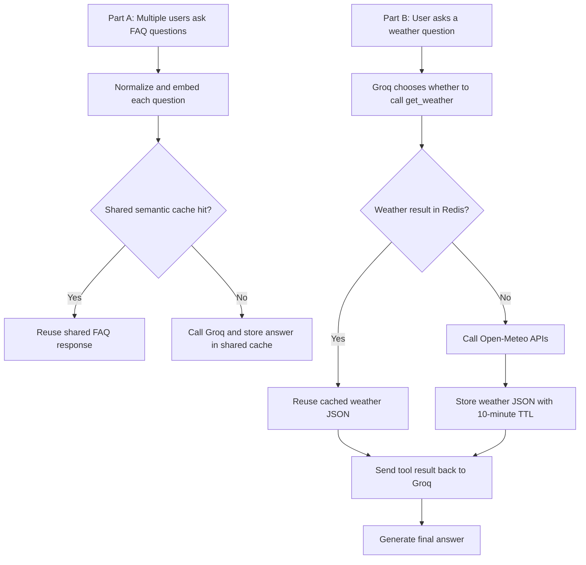

# Multi-User and Tool-Result Caching with Redis



> Two practical patterns for LLM applications: sharing semantic FAQ answers across users and caching deterministic tool outputs such as weather data.

[](https://www.python.org/)
[](https://redis.io/)
[](https://redis.io/docs/latest/develop/ai/redisvl/)
[](https://groq.com/)

## Overview

This project contains two independent examples showing how Redis can improve LLM-based applications beyond simple prompt caching:

### Part A — Multi-user shared semantic cache

Several simulated users ask related course FAQ questions. A single shared Redis semantic cache allows one user's generated answer to be reused for semantically similar questions from other users.

This is useful for public, non-personalized information such as FAQs, documentation, and product knowledge. It is not appropriate for private or user-specific answers unless user, tenant, permission, and context information are included in the cache design.

### Part B — Tool and function-call cache

A weather assistant uses Groq tool calling to decide when to call a `get_weather` function. The function checks Redis before calling the Open-Meteo geocoding and weather APIs. Weather results are cached for 10 minutes and reused for later requests about the same city.

The LLM still handles the conversation and produces the final natural-language answer. Redis reduces repeated external weather API calls inside the tool implementation.

## Architecture



The project also includes a visual architecture diagram in [`diagram.png`](./diagram.png).

## Project Structure

```
project_6_multiuser_and_tools/
├── diagram.png              # Multi-user and tool-cache architecture diagram
├── part_a_multi_user.py     # Shared semantic cache across simulated users
├── part_b_tool_cache.py     # Redis cache around a weather tool
└── README.md                # Project documentation
```

## Requirements

- Python 3.9 or newer

- Redis 7 or newer running locally on port `6379`

- RedisVL for the semantic-cache example

- A Groq API key

- Internet access for the embedding model and Open-Meteo weather requests

The weather API used in Part B is Open-Meteo and does not require an API key.

## Technology Stack

- **Python** — application logic and command-line demos

- **Redis** — shared response cache and tool-result cache

- **RedisVL** — semantic cache and local vectorization integration

- **Hugging Face Sentence Transformers** — local prompt embeddings

- **`sentence-transformers/all-MiniLM-L6-v2`** — embedding model used in Part A

- **Groq Python SDK** — LLM and tool/function-call orchestration

- **Open-Meteo** — geocoding and current weather data

- **Requests** — HTTP calls to Open-Meteo

## Installation

### 1. Clone the repository

```bash
git clone https://github.com/paras160500/Types-of-Redis-Caching-in-LLM.git
cd Types-of-Redis-Caching-in-LLM/project_6_multiuser_and_tools
```

### 2. Create and activate a virtual environment

#### macOS/Linux

```bash
python3 -m venv .venv
source .venv/bin/activate
```

#### Windows PowerShell

```
python -m venv .venv
.venv\Scripts\Activate.ps1
```

### 3. Install dependencies

```bash
pip install redis redisvl python-dotenv groq requests sentence-transformers
```

### 4. Start Redis

Run Redis with Docker:

```bash
docker run --name multiuser-tools-redis -p 6379:6379 -d redis:7-alpine
```

Verify the connection:

```bash
redis-cli ping
```

Expected output:

```
PONG
```

### 5. Configure the Groq API key

Create a `.env` file inside `project_6_multiuser_and_tools`:

```
GROQ_API_KEY=your_groq_api_key_here
```

Do not commit your API key. Add these entries to `.gitignore` if needed:

```
.env
.venv/
__pycache__/
```

## Part A: Multi-User Shared Semantic Cache

Run the shared-cache example with:

```bash
python part_a_multi_user.py
```

The script clears the shared cache, then processes a predefined list of questions from five simulated users:

```
Alice   — What are the prerequisites for the AI Engineering course?
Bob     — Do I need any prior experience before joining the AI Engineering course?
Charlie — How long does the AI Engineering course take to finish?
Dana    — What is the duration of the AI Engineering program?
Eve     — What should I know before taking the AI Engineering class?
```

The first question in a semantic group produces a cache miss and calls Groq. A later semantically related question can reuse the stored response:

```
👤 [Alice  ] ❌ CACHE MISS (...) | Q: 'What are the prerequisites for the AI Engineering course?'
  ↳ Generated & shared: ...

👤 [Bob    ] ✅ SHARED HIT (...) | Q: 'Do I need any prior experience before joining the AI Engineering course?'
  ↳ Reused answer: ...
```

At the end, the program prints the number of requests served from the shared cache.

### How Part A works

The cache is created once for all simulated users:

```python
shared_cache = SemanticCache(
    name="shared_faq_cache",
    redis_url="redis://localhost:6379",
    distance_threshold=0.25,
    vectorizer=vectorizer,
    ttl=3600,
)
```

The cache has no `user_id` in its key or lookup metadata. That is intentional for this demonstration: semantically similar public FAQ questions can share responses across users.

### Important isolation warning

A shared cache is safe only when the cached response is safe for every user who can receive it. Do not use this pattern unchanged for:

- Personal account information

- Private documents or conversations

- Tenant-specific data

- Permission-dependent answers

- Responses containing secrets or sensitive attributes

For private data, include an explicit scope in the cache key or use separate caches. A typical logical scope might include:

```
tenant_id + user_id + model_version + system_prompt_version + normalized_prompt
```

Also ensure that authorization is checked before returning cached data. Cache isolation is not a substitute for access control.

## Part B: Tool and Function-Call Cache

Run the weather tool-cache example with:

```bash
python part_b_tool_cache.py
```

The assistant uses Groq tool calling to decide whether the weather function is needed. The `get_weather()` function then caches the external API result in Redis.

Try the demonstration flow:

```
You: What is the weather in Delhi?

🌐 TOOL CACHE MISS for 'Delhi' -> Calling live Open-Meteo API...
🤖 Agent (... ms): ...

You: Should I wear a jacket in Delhi today?

⚡ TOOL CACHE HIT for 'Delhi' (TTL remaining: ...s) -> Skipped Open-Meteo API!
🤖 Agent (... ms): ...
```

Use `exit` or `quit` to stop the program.

### Tool-cache key format

The city is normalized before the Redis key is created:

```python
normalized_city = city.lower().strip()
cache_key = f"tool:weather:{normalized_city}"
```

For example, these inputs use the same key:

```
Delhi
delhi
  DELHI  
```

The current key format is:

```
tool:weather:<normalized_city>
```

### Tool-cache expiration

Weather results are stored for 600 seconds, or 10 minutes:

```python
WEATHER_TTL_SECONDS = 600
cache.set(cache_key, result_payload, ex=WEATHER_TTL_SECONDS)
```

On a cache hit, the remaining TTL is printed. After expiration, the next weather request calls Open-Meteo again and refreshes the Redis value.

### Tool-calling sequence

Part B follows this sequence:

1. Send the user's request and the weather tool schema to Groq.

1. Let the model decide whether to call `get_weather`.

1. Execute the requested tool function.

1. Check Redis before calling Open-Meteo.

1. Add the tool result to the conversation.

1. Send the conversation back to Groq for a final answer.

A tool-cache hit skips the external weather API call. It does not necessarily skip the Groq calls needed for tool selection and final response generation.

## Configuration

### Shared semantic cache

The shared FAQ cache currently uses:

```python
distance_threshold=0.25
ttl=3600
```

A lower distance threshold is more conservative and requires closer semantic matches. A higher threshold accepts broader relationships but may reuse an answer that is not accurate for the new question.

The one-hour TTL is suitable for a demo. Choose a value based on how often the FAQ content, policies, or course details change.

### Weather tool cache

The weather cache currently uses:

```python
WEATHER_TTL_SECONDS = 600
```

Shorter TTLs provide fresher weather data but increase external API requests. Longer TTLs reduce API traffic but can return older conditions.

For production, move Redis URL, TTLs, model names, and similarity thresholds into environment variables instead of hard-coding them.

## Inspecting Redis

List keys created by the weather tool cache:

```bash
redis-cli --scan --pattern 'tool:weather:*'
```

Check the remaining TTL for a city:

```bash
redis-cli TTL 'tool:weather:delhi'
```

Inspect semantic-cache keys:

```bash
redis-cli --scan --pattern '*shared*'
```

For large Redis deployments, prefer `SCAN`-based inspection over `KEYS` because `KEYS` can block Redis while scanning a large keyspace.

## Troubleshooting

### Redis connection error

Confirm that Redis is running on `localhost:6379`:

```bash
docker ps
redis-cli ping
```

### The semantic example is slow on the first run

Part A downloads and initializes the local embedding model the first time it runs. Later runs can use the local model cache.

### Part A produces too few shared hits

The questions may be outside the configured `0.25` semantic-distance threshold. Tune the threshold carefully using representative FAQ questions. A threshold that is too high can produce incorrect shared answers.

### Part B always calls Open-Meteo

Check that the city is normalized consistently and that the Redis key has not expired. Submit the same city again within 10 minutes and inspect the key with `TTL`.

### A city cannot be found

Open-Meteo geocoding may not return a result for ambiguous or misspelled city names. Try a more specific spelling or include a recognized city name.

### The model does not call the weather tool

The LLM makes the tool-selection decision. Use a clear weather-related request such as:

```
What is the current temperature in Tokyo?
```

## Limitations and Production Considerations

This project is intentionally small and educational. A production implementation should also consider:

- Adding tenant, user, permission, locale, and model-version context where responses are not globally shareable.

- Validating authorization before every cache read.

- Preventing sensitive data from entering shared caches.

- Including tool version, units, location identity, and request parameters in tool-cache keys.

- Avoiding raw user input directly in keys when it can create excessive key cardinality or unsafe key names.

- Handling time zones, ambiguous city names, country codes, units, and forecast parameters.

- Adding retries, timeouts, rate limits, and error handling for Redis, Groq, and external tools.

- Caching successful results separately from errors and deciding whether errors should ever be cached.

- Measuring cache-hit rate, external API savings, latency, stale-result rate, and answer quality.

- Using distributed locking or request coalescing to prevent duplicate upstream calls during cache misses.

- Making TTLs configurable and invalidating entries when source data or tool behavior changes.

- Protecting Redis with authentication, TLS, network controls, and appropriate eviction policies.

Cache keys must represent every input that can change a tool result. For weather, city alone may not be enough if the tool later supports units, forecast dates, country disambiguation, or additional weather fields.

## Related Projects

- [Exact-match Redis caching](../project_1_exact_match)

- [Semantic Redis caching](../project_2_semantic_match)

- [TTL-based Redis caching](../project_3_ttl_cache)

- [Embedding caching](../project_4_embedding_cache)

- [Retrieval caching](../project_5_retrieval_cache)

- [Repository home page](https://github.com/paras160500/Types-of-Redis-Caching-in-LLM)

## License

No license file is currently included in the repository. Add a license if you plan to reuse or distribute this project.

## Acknowledgements

- [Redis](https://redis.io/) for the in-memory data store and TTL support.

- [RedisVL](https://redis.io/docs/latest/develop/ai/redisvl/) for the semantic-cache integration.

- [Groq](https://groq.com/) for LLM and tool-calling support.

- [Open-Meteo](https://open-meteo.com/) for the free geocoding and weather APIs.

- [Hugging Face](https://huggingface.co/) and [Sentence Transformers](https://www.sbert.net/) for the embedding model ecosystem.