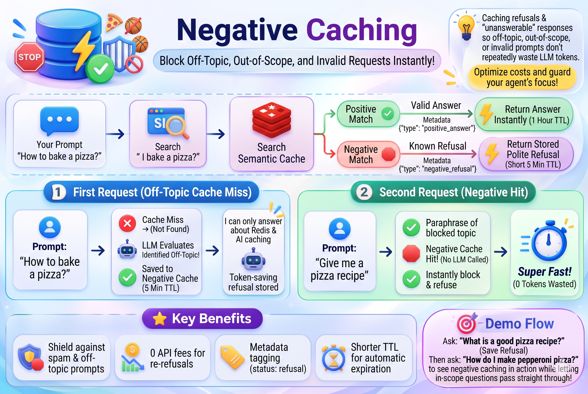
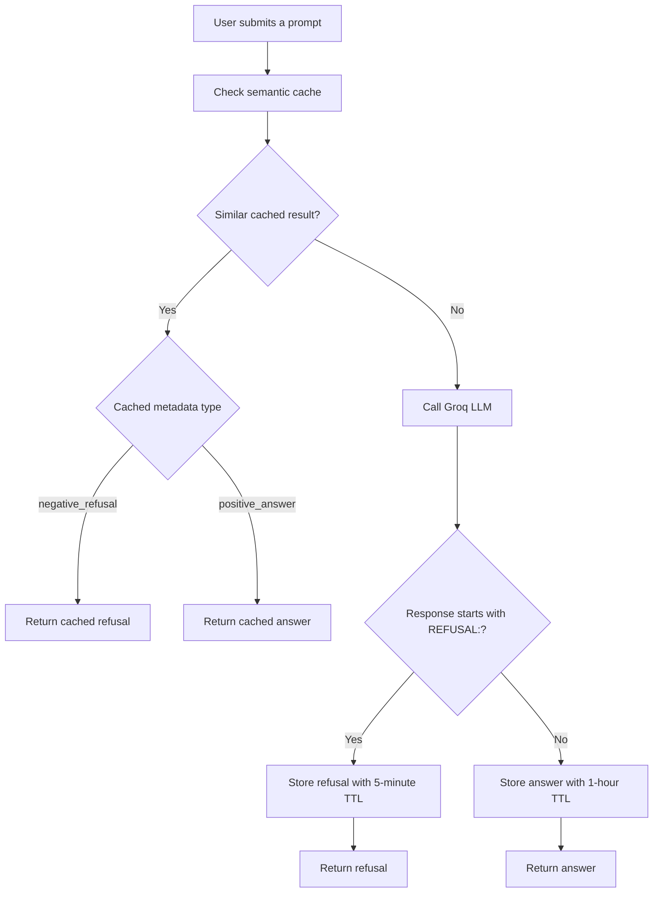

# Negative Caching for Scoped LLM Assistants




> Cache refusals and unanswerable responses so repeated off-topic requests do not repeatedly consume LLM tokens.

[](https://www.python.org/)
[](https://redis.io/)
[](https://redis.io/docs/latest/develop/ai/redisvl/)
[](https://groq.com/)

## Overview

This project demonstrates **negative caching** for a scoped LLM assistant.

A normal cache stores successful answers. A negative cache also stores known refusals, invalid requests, and unanswerable prompts. This prevents the application from calling the LLM repeatedly for questions that are already known to be outside its scope.

The example implements a strict Redis and AI Caching tutor. It stores both valid answers and refusals in Redis using RedisVL's `SemanticCache`:

- Valid responses are stored as positive cache entries.

- Off-topic responses are stored as negative cache entries.

- Metadata identifies whether a cached result is an answer or a refusal.

- Refusals use a shorter five-minute TTL.

- Valid answers use a one-hour TTL.

- Semantically similar off-topic prompts can reuse the cached refusal without another LLM call.

## Why Negative Caching Matters

In production, users or automated clients may repeatedly submit requests that are unrelated to an assistant's purpose. For example, a Redis tutor may receive questions about recipes, sports, movies, or general trivia.

Without negative caching, every repeated off-topic request can still trigger an LLM call just to produce another refusal. Negative caching helps reduce:

- Unnecessary LLM token usage

- Repeated refusal-generation latency

- API costs for known off-topic requests

- Load on the model provider

- Repeated evaluation of semantically similar invalid prompts

The approach is especially useful for domain-specific assistants, customer-support bots, internal knowledge assistants, and tools with clearly defined capabilities.

## How It Works



## Project Structure

```
ai-caching-projects/
├── project_1_exact_match/
├── project_2_semantic_match/
├── project_3_ttl_cache/
├── project_4_embedding_cache/
├── project_5_retrieval_cache/
├── project_6_multiuser_and_tools/
└── project_7_negative_cache/
    ├── main.py
    └── README.md
```

## Requirements

- Python 3.9 or newer

- Redis 7 or newer running locally on port `6379`

- A Groq API key

- Internet access to download the local embedding model and call Groq

No new packages are required if the dependencies from the previous projects are already installed. This project uses:

- `redisvl`

- `sentence-transformers`

- `groq`

- `python-dotenv`

## Installation

### 1. Clone the repository

```bash
git clone https://github.com/paras160500/Types-of-Redis-Caching-in-LLM.git
cd Types-of-Redis-Caching-in-LLM
```

### 2. Create and activate a virtual environment

#### macOS/Linux

```bash
python3 -m venv .venv
source .venv/bin/activate
```

#### Windows PowerShell

```
python -m venv .venv
.venv\Scripts\Activate.ps1
```

### 3. Install dependencies

```bash
pip install redisvl sentence-transformers groq python-dotenv
```

### 4. Start Redis

Run Redis with Docker:

```bash
docker run --name negative-cache-redis -p 6379:6379 -d redis:7-alpine
```

Verify the connection:

```bash
redis-cli ping
```

Expected output:

```
PONG
```

### 5. Configure the Groq API key

Create a `.env` file in the repository root:

```
GROQ_API_KEY=your_groq_api_key_here
```

Keep the API key out of source control. Add these entries to `.gitignore` if needed:

```
.env
.venv/
__pycache__/
```

## Run the Project

From the repository root, run:

```bash
python project_7_negative_cache/main.py
```

The application starts an interactive scoped tutor:

```
=== Project 7: Negative Cache (Scoped Tutor Bot) ===
Type 'clear' to wipe cache, or 'exit' to quit.
```

Available commands:

```
clear   # Remove all entries from the semantic cache
exit    # Quit the application
quit    # Quit the application
```

## Demonstration Flow

### 1. Negative cache miss

Enter an off-topic request:

```
You: What is a good pizza recipe?
```

The prompt is not cached yet, so the application calls Groq. The tutor refuses the request and stores the refusal with negative metadata:

```
CACHE MISS | Calling LLM to evaluate scope...
SAVED TO NEGATIVE CACHE | Will block similar off-topic prompts for 5m
Bot: I can only help with Redis, databases, and AI caching.
```

### 2. Negative cache hit

Now submit a semantically similar off-topic request:

```
You: How do I bake homemade pizza?
```

RedisVL can identify the semantic similarity and return the cached refusal without calling the LLM again:

```
NEGATIVE CACHE HIT | Known off-topic / unanswerable
Matched rejected prompt: 'What is a good pizza recipe?'
Bot: I can only help with Redis, databases, and AI caching.
```

### 3. Positive cache flow

Submit an in-scope question:

```
You: What is a semantic cache?
```

The first request calls Groq and stores the answer as a positive cache entry:

```
SAVED TO POSITIVE CACHE
Bot: ...
```

Submit a related question:

```
You: Explain semantic caching
```

The semantic cache can reuse the stored answer as a positive cache hit.

## Metadata Tagging

Each cached response is tagged with metadata so the application can distinguish a normal answer from a refusal.

Negative entries use:

```python
metadata={"type": "negative_refusal"}
```

Positive entries use:

```python
metadata={"type": "positive_answer"}
```

When a cache hit is found, the application reads the metadata:

```python
meta = hits[0].get("metadata") or {}

if meta.get("type") == "negative_refusal":
    # Handle a cached refusal
else:
    # Handle a cached answer
```

This prevents the application from treating every cached response as a successful answer.

## TTL Strategy

The project uses different expiration times for positive and negative results:

| Cache entry | Metadata type | TTL | Purpose |
| --- | --- | --- | --- |
| Refusal | `negative_refusal` | 300 seconds | Reconsider the refusal after five minutes |
| Valid answer | `positive_answer` | 3600 seconds | Reuse an in-scope answer for one hour |

Negative entries intentionally use a shorter TTL. If the assistant's capabilities expand, a previously rejected prompt should not remain blocked for too long.

The refusal is stored with:

```python
cache.store(
    prompt=prompt,
    response=clean_refusal,
    metadata={"type": "negative_refusal"},
    ttl=300,
)
```

The positive answer is stored with:

```python
cache.store(
    prompt=prompt,
    response=raw_reply,
    metadata={"type": "positive_answer"},
    ttl=3600,
)
```

## Cache Configuration

The semantic cache is initialized with:

```python
cache = SemanticCache(
    name="negative_cache_demo",
    redis_url="redis://localhost:6379",
    distance_threshold=0.25,
    vectorizer=vectorizer,
    ttl=3600,
)
```

The `distance_threshold` controls how close a new prompt must be to a cached prompt before it is considered a semantic match.

- A lower value is more conservative.

- A higher value accepts broader semantic relationships.

- A threshold that is too high can incorrectly reuse a refusal or answer for a different question.

The project uses `0.25` as a demonstration value. Tune it with representative prompts from your own application.

## Scope Enforcement

The tutor uses a system prompt to define the assistant's allowed domain:

```python
SYSTEM_PROMPT = (
    "You are a strict Redis & AI Caching tutor. "
    "ONLY answer questions about Redis, databases, or AI caching. "
    "If the user asks about ANY other topic, "
    "you MUST reply with a polite refusal."
)
```

The implementation detects refusals with a prefix:

```python
REFUSAL_PREFIX = "REFUSAL:"
```

When the LLM response starts with this prefix, the prefix is removed before the refusal is stored:

```python
clean_refusal = raw_reply.replace(REFUSAL_PREFIX, "", 1).strip()
```

This gives the application a simple and explicit way to identify negative responses.

## Inspecting Redis

List keys associated with the negative cache:

```bash
redis-cli --scan --pattern '*negative*'
```

For large Redis deployments, prefer `SCAN`-based inspection over `KEYS` because `KEYS` can block Redis while scanning a large keyspace.

The easiest way to clear the demo cache is through the application:

```
You: clear
```

## Troubleshooting

### Redis connection error

Confirm that Redis is running and listening on `localhost:6379`:

```bash
docker ps
redis-cli ping
```

### The first run is slow

The local embedding model is downloaded and initialized the first time the application runs. Later runs can use the local model cache.

### Similar off-topic prompts are not hitting the negative cache

The prompts may be outside the configured semantic distance threshold. Try a closer paraphrase first, then adjust `distance_threshold` carefully.

A lower threshold may produce more cache misses. A higher threshold may produce false matches.

### The application stores an answer as positive when it should be a refusal

The code identifies negative responses only when the LLM output starts with `REFUSAL:`. Make sure the system prompt is clear and that the model follows the required response format.

For production systems, consider using structured output or a separate scope-classification step instead of relying only on a text prefix.

### An old refusal is still returned

Refusals are cached for five minutes. Wait for the TTL to expire or use the `clear` command to remove the cache immediately.

## Negative Cache vs. Positive Cache

A positive cache stores useful answers:

```
Question → Valid answer → Cache for reuse
```

A negative cache stores known refusals or unanswerable results:

```
Off-topic question → Refusal → Cache to avoid repeated LLM calls
```

Both cache types can use semantic matching. The important difference is the meaning of the cached result and the policy applied when it is returned.

## Production Considerations

This project is designed for learning and demonstration. A production implementation should also consider:

- Using structured response fields such as `status`, `reason`, and `answer` instead of relying only on a string prefix.

- Separating scope classification from answer generation when high accuracy is required.

- Adding model version, system-prompt version, and capability version to the cache namespace.

- Using shorter TTLs for refusals than for valid answers.

- Invalidating negative entries when the assistant gains a new capability.

- Measuring false refusals and false semantic matches.

- Including tenant, user, language, and authorization context when responses are not globally shareable.

- Avoiding negative caching for prompts whose answerability can change rapidly.

- Avoiding caching sensitive user input or sensitive refusal details.

- Adding Redis and LLM retries, timeouts, and observability.

- Applying rate limits before the LLM call and before cache writes.

- Reviewing whether similar prompts truly have the same scope decision.

A negative cache is an optimization, not an authorization system. Always validate access and capability rules independently of the cache.

## Related Projects

- [Exact-match Redis caching](../project_1_exact_match)

- [Semantic Redis caching](../project_2_semantic_match)

- [TTL-based Redis caching](../project_3_ttl_cache)

- [Embedding caching](../project_4_embedding_cache)

- [Retrieval caching](../project_5_retrieval_cache)

- [Multi-user and tool caching](../project_6_multiuser_and_tools)

- [Repository home page](https://github.com/paras160500/Types-of-Redis-Caching-in-LLM)

## License

No license file is currently included in the repository. Add a license if you plan to reuse or distribute this project.

## Acknowledgements

- [Redis](https://redis.io/) for the in-memory data store and expiration support.

- [RedisVL](https://redis.io/docs/latest/develop/ai/redisvl/) for the semantic-cache integration.

- [Groq](https://groq.com/) for the LLM API used by the tutor.

- [Hugging Face](https://huggingface.co/) and [Sentence Transformers](https://www.sbert.net/) for the local embedding model ecosystem.