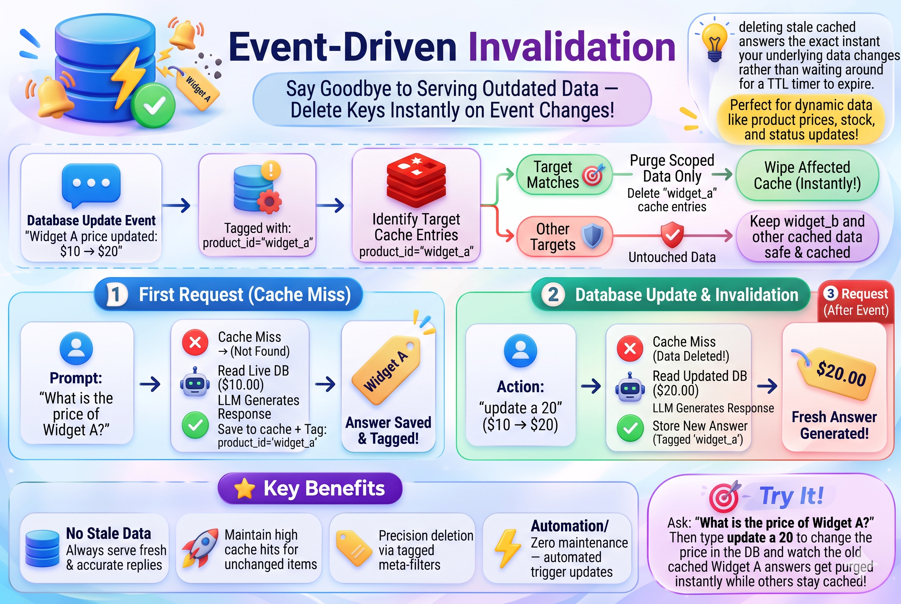
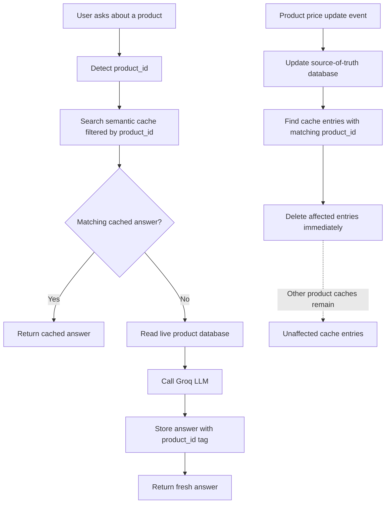

# Event-Driven Cache Invalidation with Redis




> Invalidate stale LLM responses immediately when the underlying data changes instead of waiting for a TTL to expire.

[](https://www.python.org/)
[](https://redis.io/)
[](https://redis.io/docs/latest/develop/ai/redisvl/)
[](https://groq.com/)

## Overview

This project demonstrates **event-driven cache invalidation** for an LLM-powered product assistant.

A TTL can limit how long a cached answer remains available, but it cannot remove stale data immediately. For example, if a product price is cached for 24 hours and the price changes two minutes later, the assistant could continue returning the old price for almost an entire day.

Event-driven invalidation solves this problem by deleting only the affected cache entries as soon as the source data changes.

In this example:

- Product answers are stored in a Redis semantic cache.

- Every cached answer is tagged with a `product_id`.

- A product-price update changes the source-of-truth database.

- The update immediately removes cached answers for that product.

- Cached answers for other products remain untouched.

- The next question reads the updated price and generates a fresh answer.

## Why TTL Alone Is Not Enough

TTL-based expiration is useful when data can safely remain cached for a known period. It is not sufficient when freshness is required immediately after a write event.

For example:

```
10:00 AM  Product price cached: $10.00
10:02 AM  Product price changes to: $20.00
10:02 AM  Without invalidation, cache may still return: $10.00
```

With event-driven invalidation:

```
10:02 AM  Product price changes to: $20.00
10:02 AM  Invalidation event removes Widget A cache entries
10:03 AM  Next request reads and returns: $20.00
```

The project uses a long 24-hour TTL as a safety net, while the update event handles freshness immediately.

## Architecture



## Project Structure

```
ai-caching-projects/
├── project_1_exact_match/
├── project_2_semantic_match/
├── project_3_ttl_cache/
├── project_4_embedding_cache/
├── project_5_retrieval_cache/
├── project_6_multiuser_and_tools/
├── project_7_negative_cache/
└── project_8_event_invalidation/
    ├── main.py
    └── README.md
```

## Requirements

- Python 3.9 or newer

- Redis 7 or newer running locally on port `6379`

- A Groq API key

- Internet access to download the local embedding model and call Groq

No new packages are required if the dependencies from the previous projects are already installed. This project uses:

- `redisvl`

- `sentence-transformers`

- `groq`

- `python-dotenv`

## Installation

### 1. Clone the repository

```bash
git clone https://github.com/paras160500/Types-of-Redis-Caching-in-LLM.git
cd Types-of-Redis-Caching-in-LLM
```

### 2. Create and activate a virtual environment

#### macOS/Linux

```bash
python3 -m venv .venv
source .venv/bin/activate
```

#### Windows PowerShell

```
python -m venv .venv
.venv\Scripts\Activate.ps1
```

### 3. Install dependencies

```bash
pip install redisvl sentence-transformers groq python-dotenv
```

### 4. Start Redis

Run Redis with Docker:

```bash
docker run --name event-invalidation-redis -p 6379:6379 -d redis:7-alpine
```

Verify the connection:

```bash
redis-cli ping
```

Expected output:

```
PONG
```

### 5. Configure the Groq API key

Create a `.env` file in the repository root:

```
GROQ_API_KEY=your_groq_api_key_here
```

Do not commit your API key. Add these entries to `.gitignore` if needed:

```
.env
.venv/
__pycache__/
```

## Run the Project

From the repository root, run:

```bash
python project_8_event_invalidation/main.py
```

The application starts an interactive product assistant with two types of input:

- Natural-language product questions

- Price-update commands that simulate database-change events

Available commands:

```
update a 20     # Change Widget A's price to $20.00 and invalidate its cache
update b 35     # Change Widget B's price to $35.00 and invalidate its cache
exit            # Quit the application
quit            # Quit the application
```

## Demonstration Flow

### 1. Cache a product answer

Ask:

```
You: What is the price of Widget A?
```

The application detects `widget_a`, reads the live product data, calls Groq, and stores the answer with a product tag:

```
CACHE MISS | Reading live DB (Widget A: $10.00) & calling LLM...
SAVED TO CACHE | Tagged with product_id='widget_a'
Bot: ...
```

### 2. Reuse the cached answer

Ask a semantically similar question:

```
You: How much does Widget A cost?
```

RedisVL finds the previous answer using the semantic cache and the `product_id` filter:

```
CACHE HIT | Tag: product_id=widget_a
Bot: ... $10.00 ...
```

### 3. Trigger an update event

Change the price:

```
You: update a 20
```

The application updates the source-of-truth database and immediately deletes cached answers tagged with `widget_a`:

```
EVENT: Widget A price updated: $10.00 -> $20.00
Invalidated 1 stale cached answer(s) for 'widget_a' immediately!
```

### 4. Confirm fresh data

Ask the same question again:

```
You: How much does Widget A cost?
```

The old cache entry is gone, so the application reads the updated price and generates a fresh response:

```
CACHE MISS | Reading live DB (Widget A: $20.00) & calling LLM...
SAVED TO CACHE | Tagged with product_id='widget_a'
Bot: ... $20.00 ...
```

## How It Works

### 1. Product-scoped cache

The semantic cache is configured with a filterable `product_id` field:

```python
price_cache = SemanticCache(
    name="product_price_cache",
    redis_url="redis://localhost:6379",
    distance_threshold=0.25,
    vectorizer=vectorizer,
    filterable_fields=[{"name": "product_id", "type": "tag"}],
    ttl=86400,
)
```

The `product_id` tag allows the application to search and delete entries belonging to one product without affecting other products.

### 2. Storing tagged answers

When an answer is generated, it is stored with the product identifier:

```python
price_cache.store(
    prompt=prompt,
    response=answer,
    filters={"product_id": product_id},
)
```

The cache entry contains the prompt, response, embedding, and product metadata used for filtering.

### 3. Filtering cache lookups

Before returning a semantic cache hit, the application restricts the search to the detected product:

```python
product_filter = Tag("product_id") == product_id
hits = price_cache.check(
    prompt=prompt,
    filter_expression=product_filter,
    num_results=1,
)
```

This prevents a semantically similar question about one product from accidentally returning an answer cached for another product.

### 4. Event-driven invalidation

When the product price changes, the application deletes entries matching the affected product tag:

```python
result = price_cache._index.drop_by_filter(
    Tag("product_id") == product_id
)
```

Only entries for that product are removed. Cache entries for other products remain available.

> The example uses the cache index's `drop_by_filter` operation directly to demonstrate selective invalidation. For a production application, wrap this behavior in a small repository or cache-management abstraction so application code is not tightly coupled to private library internals.

## Product Database

The project uses a small in-memory dictionary as its simulated source of truth:

```python
PRODUCT_DB = {
    "widget_a": {
        "name": "Widget A",
        "price": 10.00,
        "stock": "In Stock",
    },
    "widget_b": {
        "name": "Widget B",
        "price": 25.00,
        "stock": "In Stock",
    },
}
```

In a real application, this dictionary would be replaced by a database or service that emits events when product data changes.

## Product Detection

The demo uses a simple helper to identify the product mentioned in a prompt:

```python
def detect_product_id(prompt: str) -> str:
    prompt = prompt.lower()
    if "widget b" in prompt:
        return "widget_b"
    return "widget_a"
```

This keeps the example easy to follow, but it is intentionally limited. A production system should use reliable entity extraction, structured product IDs, or an explicit product-selection field.

## TTL and Invalidation Strategy

The cache uses a 24-hour TTL:

```python
ttl=86400
```

The TTL acts as a fallback in case an invalidation event is missed or a source system fails to publish an event. The event-driven update provides immediate invalidation when the application knows that product data has changed.

This combination provides two layers of freshness protection:

1. **Event invalidation** removes known-stale entries immediately.

1. **TTL expiration** eventually removes entries even if an event is not received.

## TTL vs. Event-Driven Invalidation

| Strategy | Best for | Main limitation |
| --- | --- | --- |
| TTL expiration | Data that can tolerate bounded staleness | Stale data may remain until the timer expires |
| Event-driven invalidation | Data that must refresh immediately after updates | Requires reliable change events |
| TTL plus events | Production systems needing freshness and a safety net | More moving parts to operate |

Event-driven invalidation is especially useful for prices, inventory, permissions, feature flags, account status, and other data that can change independently of user requests.

## Testing Selective Invalidation

To verify that only the affected product is invalidated:

1. Ask about Widget A and Widget B so both products have cached answers.

1. Run `update a 20`.

1. Ask about Widget A again and confirm a cache miss with the new price.

1. Ask about Widget B and confirm that its cached answer remains available.

Expected behavior:

```
Widget A  → Invalidated and regenerated
Widget B  → Existing cache entry remains available
```

## Troubleshooting

### Redis connection error

Confirm that Redis is running and available at `localhost:6379`:

```bash
docker ps
redis-cli ping
```

### The first run is slow

The local embedding model is downloaded and initialized the first time the program runs. Later runs can use the local model cache.

### The update command is rejected

Use the exact command format:

```
update a 20.00
update b 35.00
```

The product must be `a` or `b`, and the price must be a valid number.

### The cache returns the wrong product

The demonstration's product detection is intentionally simple. Verify that the prompt contains `Widget A` or `Widget B`. For production, replace the helper with structured entity extraction and always apply an explicit product filter.

### The old price is still returned

Confirm that the update event was processed successfully and that the cache entry was tagged with the expected `product_id`. Also verify that the application and inspection tools are connected to the same Redis instance.

### Invalidation does not remove all expected entries

Check that every cache write includes the correct `product_id` filter. Entries written without the tag cannot be selected by a tag-based invalidation event.

## Production Considerations

This project is designed for learning and demonstration. A production implementation should also consider:

- Publishing invalidation events from the actual database or domain-event system.

- Using reliable delivery with retries, acknowledgements, and dead-letter handling.

- Making invalidation idempotent so processing the same event more than once is safe.

- Including product version or update timestamps in cache metadata.

- Invalidating all dependent entities when one update affects multiple products or collections.

- Replacing simple string matching with reliable product identity resolution.

- Keeping authorization and tenant scope in cache filters where required.

- Avoiding private library APIs when a stable public invalidation interface is available.

- Monitoring event lag, invalidation failures, cache-hit rate, stale-response rate, and regeneration latency.

- Keeping a TTL as a fallback even when event-driven invalidation is enabled.

- Handling race conditions between a database update, cache read, and invalidation event.

- Using transactions or version checks when strict read-after-write consistency is required.

The most important rule is that every cache entry must contain enough metadata to identify every source entity that can make its response stale.

## Related Projects

- [Exact-match Redis caching](../project_1_exact_match)

- [Semantic Redis caching](../project_2_semantic_match)

- [TTL-based Redis caching](../project_3_ttl_cache)

- [Embedding caching](../project_4_embedding_cache)

- [Retrieval caching](../project_5_retrieval_cache)

- [Multi-user and tool caching](../project_6_multiuser_and_tools)

- [Negative caching](../project_7_negative_cache)

- [Repository home page](https://github.com/paras160500/Types-of-Redis-Caching-in-LLM)

## License

No license file is currently included in the repository. Add a license if you plan to reuse or distribute this project.

## Acknowledgements

- [Redis](https://redis.io/) for the in-memory data store and filtering support.

- [RedisVL](https://redis.io/docs/latest/develop/ai/redisvl/) for the semantic-cache integration.

- [Groq](https://groq.com/) for the LLM API used by the product assistant.

- [Hugging Face](https://huggingface.co/) and [Sentence Transformers](https://www.sbert.net/) for the local embedding model ecosystem.