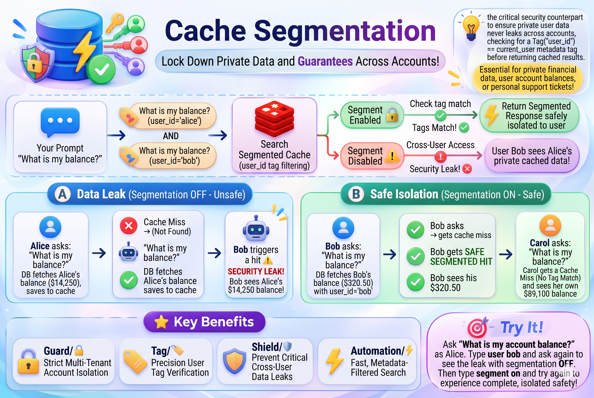
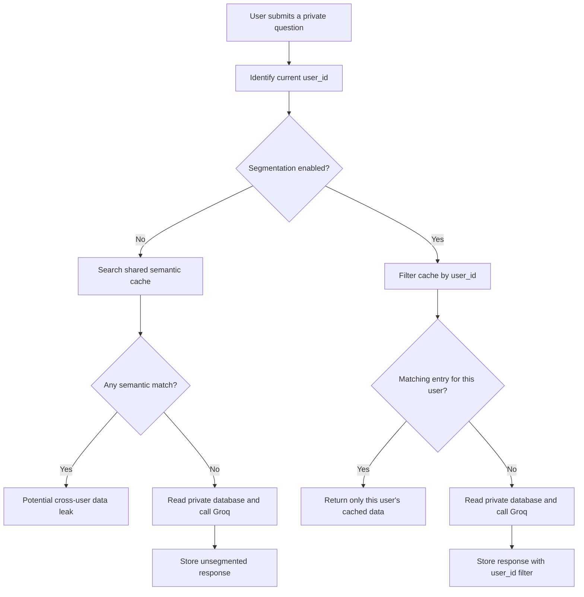

# Cache Segmentation for Multi-Tenant Data Isolation




> Prevent private user data from leaking across accounts by segmenting semantic cache entries by `user_id`.

[](https://www.python.org/)
[](https://redis.io/)
[](https://redis.io/docs/latest/develop/ai/redisvl/)
[](https://groq.com/)

## Overview

This project demonstrates **cache segmentation**, a critical security pattern for multi-user and multi-tenant LLM applications.

A semantic cache can match similar prompts even when they come from different users. That is useful for public FAQs, but dangerous for private requests. For example, two users may both ask:

```
What is my account balance?
```

The prompt does not contain a user ID. If the response is stored in one shared cache without segmentation, the second user could receive the first user's private financial information.

This project demonstrates both sides of the problem:

- **Segmentation OFF:** reproduces a cross-user data leak through a shared semantic cache.

- **Segmentation ON:** filters every cache lookup and write by `user_id`, preventing users from receiving another user's data.

> Cache segmentation is an access-control safeguard for cached data. It should complement, not replace, normal authentication and authorization checks.

## The Security Risk

Without user-aware cache filters, the flow can look like this:

```
Alice asks: What is my account balance?
→ LLM returns Alice's private balance
→ Response is stored in a shared semantic cache

Bob asks: What is my account balance?
→ Semantic cache matches Alice's prompt
→ Bob receives Alice's private balance
```

The wording is semantically identical, but the data must not be shared.

With segmentation enabled:

```
Alice asks: What is my account balance?
→ Stored with user_id=alice

Bob asks: What is my account balance?
→ Search is restricted to user_id=bob
→ Alice's cache entry is invisible to Bob
```

## Architecture



## Project Structure

```
ai-caching-projects/
├── project_1_exact_match/
├── project_2_semantic_match/
├── project_3_ttl_cache/
├── project_4_embedding_cache/
├── project_5_retrieval_cache/
├── project_6_multiuser_and_tools/
├── project_7_negative_cache/
├── project_8_event_invalidation/
└── project_9_cache_segmentation/
    ├── main.py
    └── README.md
```

## Requirements

- Python 3.9 or newer

- Redis 7 or newer running locally on port `6379`

- A Groq API key

- Internet access to download the local embedding model and call Groq

No new packages are required if the dependencies from the previous projects are already installed. This project uses:

- `redisvl`

- `sentence-transformers`

- `groq`

- `python-dotenv`

## Installation

### 1. Clone the repository

```bash
git clone https://github.com/paras160500/Types-of-Redis-Caching-in-LLM.git
cd Types-of-Redis-Caching-in-LLM
```

### 2. Create and activate a virtual environment

#### macOS/Linux

```bash
python3 -m venv .venv
source .venv/bin/activate
```

#### Windows PowerShell

```
python -m venv .venv
.venv\Scripts\Activate.ps1
```

### 3. Install dependencies

```bash
pip install redisvl sentence-transformers groq python-dotenv
```

### 4. Start Redis

Run Redis with Docker:

```bash
docker run --name cache-segmentation-redis -p 6379:6379 -d redis:7-alpine
```

Verify the connection:

```bash
redis-cli ping
```

Expected output:

```
PONG
```

### 5. Configure the Groq API key

Create a `.env` file in the repository root:

```
GROQ_API_KEY=your_groq_api_key_here
```

Do not commit your API key. Add these entries to `.gitignore` if needed:

```
.env
.venv/
__pycache__/
```

## Run the Project

From the repository root, run:

```bash
python project_9_cache_segmentation/main.py
```

The application starts with segmentation disabled so the security problem can be observed first:

```
=== Project 9: Cache Segmentation (Tenant Isolation) ===
```

Available commands:

```
user alice       # Switch to Alice
user bob         # Switch to Bob
user carol       # Switch to Carol
segment on       # Enable per-user cache isolation
segment off      # Disable isolation and use a shared cache
clear            # Delete all cached entries
exit             # Quit the application
quit             # Quit the application
```

## Demonstration: Reproduce the Data Leak

### Step 1: Leave segmentation disabled

The program starts with segmentation disabled:

```
Segmentation: OFF (Unsafe - Shared)
```

As Alice, ask:

```
You: What is my account balance?
```

The application reads Alice's private record, calls Groq, and stores the response in the shared cache:

```
CACHE MISS | Fetching private DB for 'alice' & calling LLM...
SAVED TO CACHE | Segment: user_id='alice'
Bot: ... $14,250.00 ...
```

### Step 2: Switch to Bob

```
You: user bob
```

Then ask the same question:

```
You: What is my account balance?
```

Because segmentation is disabled, Bob can receive Alice's cached response:

```
SECURITY LEAK! | Bob received Alice's cached data!
Bot: ... $14,250.00 ...
```

This is the vulnerability the project is designed to demonstrate.

## Demonstration: Fix the Leak with Segmentation

### Step 1: Clear the unsafe cache

```
You: clear
```

### Step 2: Enable segmentation

```
You: segment on
```

The prompt now shows:

```
Segmentation: ON (Safe)
```

### Step 3: Ask as Bob

```
You: user bob
You: What is my account balance?
```

Bob receives his own private value and the cache entry is tagged with `user_id=bob`:

```
CACHE MISS | Fetching private DB for 'bob' & calling LLM...
SAVED TO CACHE | Segment: user_id='bob'
Bot: ... $320.50 ...
```

### Step 4: Ask as Carol

```
You: user carol
You: What is my account balance?
```

Carol cannot match Bob's cache entry because the lookup is restricted to `user_id=carol`. She gets a cache miss and her own private balance:

```
CACHE MISS | Fetching private DB for 'carol' & calling LLM...
SAVED TO CACHE | Segment: user_id='carol'
Bot: ... $89,100.00 ...
```

## How Segmentation Works

### 1. Define a filterable user field

The semantic cache declares `user_id` as a filterable tag:

```python
segmented_cache = SemanticCache(
    name="segmented_user_cache",
    redis_url="redis://localhost:6379",
    distance_threshold=0.25,
    vectorizer=vectorizer,
    filterable_fields=[{"name": "user_id", "type": "tag"}],
    ttl=3600,
)
```

### 2. Apply the user filter during lookup

When segmentation is enabled, every cache lookup is restricted to the active user:

```python
user_filter = Tag("user_id") == user_id
hits = segmented_cache.check(
    prompt=prompt,
    filter_expression=user_filter,
    num_results=1,
)
```

This means Bob's request can only match entries tagged `user_id=bob`. Alice's entries are excluded before the semantic result is returned.

### 3. Store the response in the correct segment

Every private response is stored with the corresponding user ID:

```python
segmented_cache.store(
    prompt=prompt,
    response=answer,
    filters={"user_id": user_id},
    metadata={"owner": user_id},
)
```

The `filters` field controls cache segmentation. The `metadata.owner` value is also stored for demonstration and leak detection.

## Cache Configuration

The project uses:

```python
distance_threshold=0.25
ttl=3600
```

The one-hour TTL controls how long private responses remain cached. A TTL is useful for cleanup, but it is not a substitute for segmentation. Even a one-second period of cross-user visibility can be a serious security issue.

The `distance_threshold` controls semantic matching. Tune it carefully because a permissive threshold can match unrelated questions, while a strict threshold can reduce cache reuse.

## Simulated Private Data

The demo uses an in-memory dictionary as a stand-in for a private database:

```python
PRIVATE_USER_DB = {
    "alice": {
        "balance": "$14,250.00",
        "ticket": "Ticket #401 (Resolved)",
    },
    "bob": {
        "balance": "$320.50",
        "ticket": "Ticket #889 (In Progress)",
    },
    "carol": {
        "balance": "$89,100.00",
        "ticket": "Ticket #912 (Awaiting Reply)",
    },
}
```

In a real application, this data would come from an authenticated service or database. The cache must use the authenticated identity from the request context rather than trusting a user ID supplied in the prompt.

## Why Metadata Alone Is Not Enough

The project stores both a filter and owner metadata:

```python
filters={"user_id": user_id}
metadata={"owner": user_id}
```

Metadata is useful for observability, debugging, and detecting unexpected matches. However, metadata by itself does not enforce isolation. The cache lookup must apply a filter before returning the response:

```python
filter_expression=(Tag("user_id") == user_id)
```

Security must be enforced at lookup time, not only recorded after the response is generated.

## Cache Segmentation vs. Shared Caching

| Cache design | Suitable for | Security risk |
| --- | --- | --- |
| Shared semantic cache | Public FAQs and non-personalized content | Private data can leak across users |
| User-segmented cache | Personal accounts and private conversations | Requires correct identity and filters |
| Tenant-segmented cache | Multi-tenant applications | Requires strict tenant boundaries |
| User plus tenant segmentation | Enterprise systems with nested access scopes | More metadata and operational complexity |

Use a shared cache only when the response is genuinely safe for every user who can access it.

## Testing Checklist

Use this sequence to verify the behavior:

1. Start the application with segmentation OFF.

1. Ask Alice: `What is my account balance?`

1. Switch to Bob with `user bob`.

1. Ask Bob the same question and observe the security leak.

1. Run `clear`.

1. Run `segment on`.

1. Ask Bob the question again and confirm Bob receives `$320.50`.

1. Switch to Carol with `user carol`.

1. Ask the same question and confirm Carol receives `$89,100.00`.

1. Confirm that Bob's cached result is not reused for Carol.

## Troubleshooting

### Redis connection error

Confirm that Redis is running on `localhost:6379`:

```bash
docker ps
redis-cli ping
```

### The first run is slow

The local embedding model is downloaded and initialized the first time the program runs. Later runs can use the local model cache.

### Bob still receives Alice's data when segmentation is ON

Confirm that:

- The cache was cleared before the safe test.

- `segment on` was entered exactly.

- The lookup applies `Tag("user_id") == user_id`.

- Every cache write includes `filters={"user_id": user_id}`.

- The application is connected to the expected Redis instance.

### A user cannot reuse their own cached answer

The user ID in the lookup must exactly match the user ID used during storage. Check for casing, whitespace, and inconsistent identity formats.

### The same prompt matches unexpectedly

The semantic cache uses a similarity threshold. If the threshold is too high, semantically related but materially different private questions may be treated as equivalent. Lower the threshold and test with realistic private prompts.

## Production Security Considerations

This project is a demonstration of a serious cache-isolation requirement. A production implementation should also consider:

- Deriving `user_id` and `tenant_id` from authenticated session or token claims.

- Never trusting identity values supplied by the user in free-form prompt text.

- Applying authorization checks before cache reads and writes.

- Including every relevant access scope in the cache filter, such as tenant, role, region, and document permissions.

- Using separate namespaces when stronger physical isolation is required.

- Avoiding shared caches for responses containing secrets, financial data, health data, or personal information unless segmentation is rigorously enforced.

- Auditing cache hits, misses, filters, and owner metadata without logging sensitive response content unnecessarily.

- Testing cross-user and cross-tenant prompts as part of security regression tests.

- Handling identity changes, account deletion, permission changes, and tenant offboarding with explicit invalidation.

- Using encryption, TLS, authentication, network controls, and least-privilege Redis access.

- Including model version, system-prompt version, and authorization-policy version in cache namespaces where changes affect response validity.

A cache hit should never bypass authorization. The application must validate the current user's access independently, then apply the same scope to the cache lookup.

## Related Projects

- [Exact-match Redis caching](../project_1_exact_match)

- [Semantic Redis caching](../project_2_semantic_match)

- [TTL-based Redis caching](../project_3_ttl_cache)

- [Embedding caching](../project_4_embedding_cache)

- [Retrieval caching](../project_5_retrieval_cache)

- [Multi-user and tool caching](../project_6_multiuser_and_tools)

- [Negative caching](../project_7_negative_cache)

- [Event-driven invalidation](../project_8_event_invalidation)

- [Repository home page](https://github.com/paras160500/Types-of-Redis-Caching-in-LLM)

## License

No license file is currently included in the repository. Add a license if you plan to reuse or distribute this project.

## Acknowledgements

- [Redis](https://redis.io/) for the in-memory data store and filtering support.

- [RedisVL](https://redis.io/docs/latest/develop/ai/redisvl/) for the semantic-cache integration.

- [Groq](https://groq.com/) for the LLM API used by the account assistant.

- [Hugging Face](https://huggingface.co/) and [Sentence Transformers](https://www.sbert.net/) for the local embedding model ecosystem.